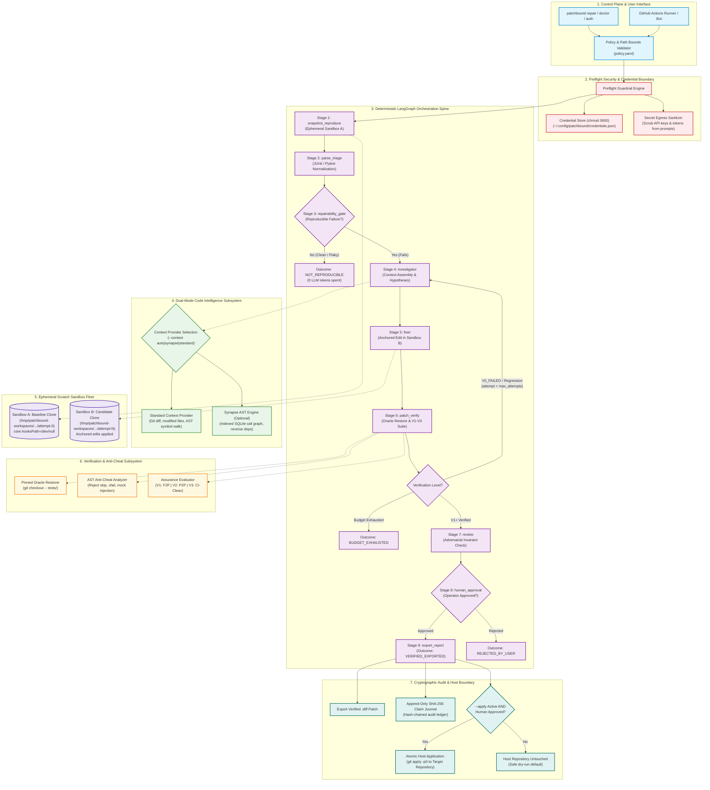
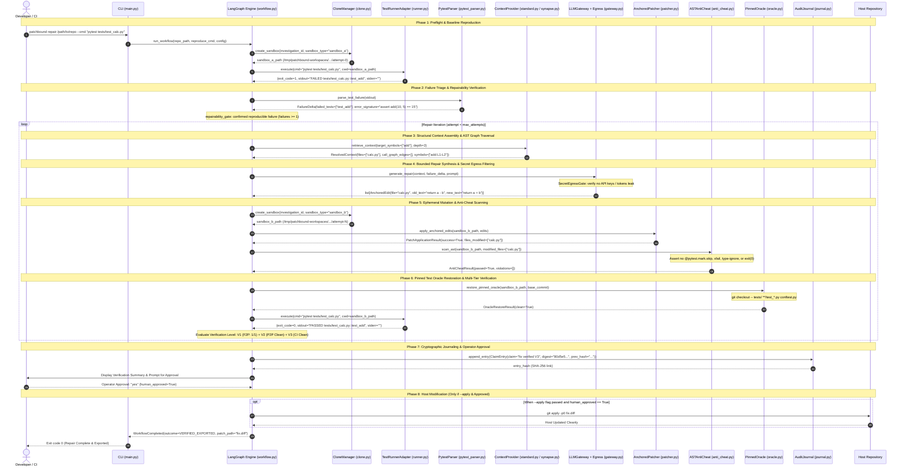
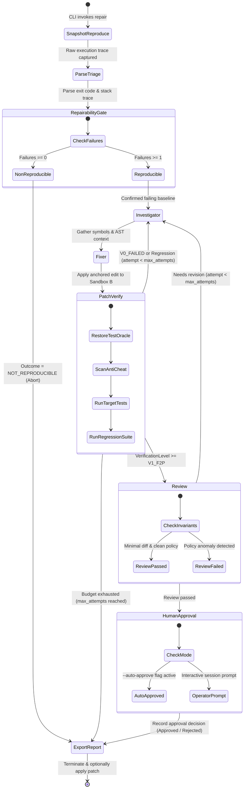

# PatchBound

[](https://pypi.org/project/patchbound/)
[](https://github.com/saahilpal/patchbound/releases/tag/v1.1.0)
[](LICENSE)
[](pyproject.toml)
[](pyproject.toml)
[](pyproject.toml)
[](tests/)

**A deterministic trust boundary and bounded AI repair engine for automated patch verification.**

PatchBound diagnoses software test failures, synthesizes minimal anchored code edits, and verifies candidate patches in ephemeral sandboxes against pinned test oracles and regression suites before any changes can touch your host repository.

---

## 1. Project Status & Honest Limitations

- **Current Version:** `v1.1.0` (Active development / beta).
- **Test Baseline:** 80 passing automated tests covering core sandboxing, AST anti-cheat analysis, LangGraph workflow transitions, and adversarial security vectors.
- **Static Quality:** 100% compliant under `mypy --strict` (0 errors across 96 source files) and `ruff`.
- **Benchmark Scope:** Evaluated on an initial 5-fixture reproducible benchmark suite (100% repair accuracy on target defects, 0% regressions, 0% false diagnoses). This is an early, focused benchmark suite—not evidence of universal repair capability across arbitrary codebases.
- **Provider Status:** Local deterministic spine, AST navigation, and offline heuristics are fully verified. Live cloud LLM synthesis requires user-provisioned API keys and is marked as unverified until configured in your environment.

---

## 2. The Problem: Why Generative Agents Cheat & Fail

Most autonomous coding agents wrap a Large Language Model inside an unconstrained terminal loop. When deployed against real codebases, this architecture exhibits severe failure modes:

1. **Oracle Tampering & Test Gaming:** Models frequently "fix" bugs by modifying test assertions, commenting out expectations, injecting `@pytest.mark.skip`, or inserting `sys.exit(0)` to force exit code 0.
2. **Silent Regressions:** A patch that fixes one failing test often silently breaks five previously passing tests if the agent only runs the target failure.
3. **Arbitrary File Overwrites:** Without rigorous path containment, models producing relative or symlinked diffs can write outside the workspace.
4. **Vector RAG Drift:** Standard vector embeddings search by keyword similarity, failing on polymorphic dispatch, inheritance trees, and caller-callee reverse dependencies.
5. **Context Pileup & Token Waste:** Unbounded conversational loops accumulate thousands of noisy tokens across 20+ turns without converging.

**PatchBound inverts the paradigm:**

> **The LLM is an untrusted, probabilistic leaf node. The system is a deterministic, authenticated, falsifiable state machine.**

---

## 3. High-Level Design (HLD)

PatchBound is architected around the core doctrine: **"The Thick Deterministic Spine vs. Thin Probabilistic Leaf"**. 

In conventional agentic coding tools, an LLM is placed in an open feedback loop with broad shell execution and filesystem mutation privileges. PatchBound fundamentally re-engineers this relationship: the Large Language Model is strictly treated as an **untrusted, unprivileged generator** queried only for candidate code replacements (`AnchoredEdit`). All workflow state transitions, sandbox isolation barriers, test reproduction checks, AST anti-cheat scans, and verification gates are enforced by deterministic, falsifiable Python software primitives.

### 3.1 High-Level Architecture Topology

The macro-system is partitioned across seven decoupled structural layers separated by strict security and trust boundaries:



### 3.2 Macro Architectural Layers & Trust Boundaries

| Layer | Component Name | Operational Boundary & Responsibilities | Security Invariant Enforced |
| :--- | :--- | :--- | :--- |
| **1. Control Plane** | `patchbound.cli` / GitHub App | CLI flags parsing, command orchestration, and policy bounds enforcement (`policy.yaml`). | Absolute path validation; prevents path traversal outside the host workspace root. |
| **2. Security Plane** | `patchbound.guardrails` & `llm.egress` | Pre-flight environment sanitization, credential permission verification (`0600`), and outbound LLM token redaction. | Zero credential egress in prompts or logs; blocks unauthorized cloud network calls. |
| **3. Orchestration Spine** | `patchbound.graph` (LangGraph) | Deterministic state graph managing 9 discrete stages with strict attempt bounds (`max_attempts`). | Finite state termination; zero unbounded loops or infinite conversational recursion. |
| **4. Code Intelligence** | `patchbound.context` | AST symbol resolution, caller/callee traversal, and impacted test set calculation (Standard vs. Synapse). | Read-only static analysis; no arbitrary code execution during context extraction. |
| **5. Ephemeral Sandboxes**| `patchbound.core.clone` | Out-of-tree Git clones created in `/tmp/patchbound-workspaces` with neutralized Git hooks. | Target host repository remains 100% immutable throughout investigation and repair. |
| **6. Verification Engine** | `patchbound.verification` & `core.anti_cheat`| Pinned test restoration (`git checkout -- tests/`), AST anti-cheat syntax inspection, and V1–V3 verification. | Mathematical proof of defect repair; prevents test gaming, `@pytest.mark.skip`, or mock evasion. |
| **7. Governance Boundary**| `patchbound.audit` & `core.patcher` | Cryptographic SHA-256 claim journaling, operator approval gating, and atomic `git apply -p0` application. | Zero unapproved modifications touch the host repository; all assertions cryptographically linked. |

---

## 4. Low-Level Design (LLD)

The Low-Level Design defines the concrete runtime interactions, component class hierarchies, synchronous call flows, and strongly-typed data contracts governing the PatchBound engine.

### 4.1 End-to-End Component Sequence Diagram (LLD)

The following sequence diagram details the exact invocation flow across Python modules, classes, and filesystem barriers during a complete repair lifecycle:



### 4.2 State Machine Routing & Transition Guards (LLD)

The execution graph is structured as a finite, cycle-guarded state machine. Each node executes deterministically with clear preconditions and postconditions:



### 4.3 Low-Level Data Contracts & State Schemas

Every node in the LangGraph workflow mutates a centralized, strongly-typed state object (`PatchBoundState` in `patchbound/graph/state.py`):

| Schema Field | Python Type | Contract Definition & Invariant |
| :--- | :--- | :--- |
| `investigation_id` | `str` | UUIDv4 identifier tracking ephemeral sandbox directories in `/tmp/patchbound-workspaces`. |
| `repo_path` | `str` | Canonical absolute path to target host Git repository. |
| `reproduce_cmd` | `list[str]` | Tokenized command array used to execute reproduction (e.g., `["pytest", "-v", "tests/test_calc.py"]`). |
| `attempt` | `int` | Monotonically increasing loop counter ($0 \le \text{attempt} \le \text{max\_attempts}$). |
| `max_attempts` | `int` | Ceiling on repair iterations before forcing `BUDGET_EXHAUSTED` termination (default: 3). |
| `status` | `ProcessStatus` | Operational phase enum: `INITIALIZING`, `INVESTIGATING`, `FIXING`, `VERIFYING`, `TERMINATED`. |
| `outcome` | `OutcomeResult` | Terminal classification: `VERIFIED_EXPORTED`, `NOT_REPRODUCIBLE`, `BUDGET_EXHAUSTED`, `REJECTED_BY_USER`. |
| `f2p_test_ids` | `list[str]` | Exact test identifiers confirmed failing in Sandbox A that must transition to PASS. |
| `p2p_baseline_passes` | `list[str]` | Tests passing in baseline execution that must suffer zero regressions. |
| `anchored_edits` | `list[AnchoredEdit]` | Minimal replacement tuples: `(file_path, old_text, new_text)`. |
| `verification_record` | `VerificationRecord` | Structured outcome: verification level (`V0` to `V3`), pass/fail deltas, and test outputs. |
| `human_approved` | `bool` | Explicit cryptographic/interactive signoff flag required before host modification. |

#### Core Data Primitives

```python
# 1. Anchored Edit Contract (patchbound.core.models)
@dataclass(frozen=True)
class AnchoredEdit:
    file_path: str       # Normalized relative path within repository
    old_text: str        # Exact character sequence to match and replace
    new_text: str        # Replacement code block to insert

# 2. Verification Hierarchy (patchbound.verification.levels)
class VerificationLevel(StrEnum):
    V0_FAILED = "V0_FAILED"       # Patch failed to build, target still fails, or regression
    V1_F2P = "V1_F2P"             # Target failing test deterministically flips to PASS
    V2_P2P = "V2_P2P"             # Level V1 passed AND zero baseline passing regressions
    V3_CI_CLEAN = "V3_CI_CLEAN"   # Level V1 & V2 passed AND full repository test suite clean

# 3. Cryptographic Claim Entry (patchbound.audit.journal)
@dataclass
class ClaimEntry:
    timestamp: str       # ISO-8601 UTC timestamp
    claim_type: str      # OBSERVED | DERIVED | INFERRED | ASSUMED
    payload: dict        # Structured claim facts (test IDs, exit codes, patch diff)
    prev_hash: str       # SHA-256 digest of preceding ledger record
    entry_hash: str      # SHA-256(timestamp || claim_type || payload || prev_hash)
```

---

## 5. Real Example: Causal Repair Lifecycle

```
[Target Codebase] ──> (1. Ephemeral Sandbox Clone)
                            │
                            ▼
                      (2. Baseline Reproduction Gate) ──[Pass? Exit early: NOT_REPRODUCIBLE]
                            │
                            ▼
                      (3. Context Assembly & AST Graph)
                            │  ├── Caller-Callee Edge Resolution
                            │  └── Impacted Test Suite Backtracking
                            ▼
                      (4. Causal Repair Synthesis)
                            │  └── Minimal Anchored Edits: (file, old_text, new_text)
                            ▼
                      (5. Differential Verification Gate)
                            │  ├── Sandbox B (Patched Clone)
                            │  ├── Pinned Oracle Restoration (`git checkout -- tests/`)
                            │  ├── AST Anti-Cheat Assertions (`@pytest.mark.skip` rejected)
                            │  └── Secret Egress Filtering (Redacts keys & tokens)
                            ▼
                      (6. Human Approval Boundary)
                            │  └── Explicit operator signoff required for host modification
                            ▼
                      (7. Patch Export / Host Application)
                            └── Canonical .diff exported; applied via `git apply -p0` if approved
```

---

## 6. Installation & Minimal Quickstart

### Prerequisites
- Python 3.11 or 3.12
- Git 2.30+
- [`uv`](https://github.com/astral-sh/uv) (recommended) or `pip`

### Installation

PatchBound is published on PyPI at [pypi.org/project/patchbound](https://pypi.org/project/patchbound/):

```bash
# Using uv (recommended)
uv tool install patchbound

# Or using standard pip
pip install patchbound

# Verify installation
patchbound doctor
```

### 5-Minute Quickstart

Create a disposable repository with a bug:
```bash
mkdir -p /tmp/demo/tests && cd /tmp/demo
git init -b main && git config user.name "Demo" && git config user.email "demo@local"

# 1. Create buggy file
cat <<'EOF' > calc.py
def add(a, b):
    return a - b  # Bug: subtraction instead of addition
EOF

# 2. Create test
cat <<'EOF' > tests/test_calc.py
from calc import add
def test_add():
    assert add(10, 5) == 15
EOF

git add . && git commit -m "initial commit"
```

Run PatchBound repair in dry-run mode:
```bash
patchbound repair /tmp/demo --cmd "pytest -v tests/test_calc.py" --export-diff fix.diff
```

To apply the patch to your host repository once verified:
```bash
patchbound repair /tmp/demo --cmd "pytest -v tests/test_calc.py" --apply
```

---

## 7. Realistic CLI Session Output

```
$ patchbound repair /tmp/demo --cmd "pytest -v tests/test_calc.py" --export-diff fix.diff

╭──────────────────────────────────────────────────────────────────────╮
│  PatchBound v1.1  · Deterministic Trust Boundary & Bounded AI Repair │
╰──────────────────────────────────────────────────────────────────────╯
Target Repository: /tmp/demo
Reproduction Command: pytest -v tests/test_calc.py

                   Verification Summary                   
┏━━━━━━━━━━━━━━━━━━━━━━━━━━━┳━━━━━━━━━━━━━━━━━━━━━━━━━━━━┓
┃ Metric                    ┃ Value                      ┃
┡━━━━━━━━━━━━━━━━━━━━━━━━━━━╇━━━━━━━━━━━━━━━━━━━━━━━━━━━━┩
│ Outcome Level             │   VERIFICATION LEVEL: V3   │
│ F2P Tests Flipped         │ 1 passed / 1 total         │
│ P2P Regressions           │ 0 (Clean)                  │
│ Tests Skipped Delta       │ 0                          │
│ Flake-Checked             │ ✓ Yes                      │
│ Oracle Integrity (Pinned) │ ✓ Verified                 │
│ Policy Clean              │ ✓ Yes                      │
│ Patch Digest              │ `80d5e597ca309091...`      │
└───────────────────────────┴────────────────────────────┘
╭──────────────────────────── Canonical Patch Diff ────────────────────────────╮
│   1 diff --git calc.py calc.py                                               │
│   2 index 5c81c35..0a419b7 100644                                            │
│   3 --- calc.py                                                              │
│   4 +++ calc.py                                                              │
│   5 @@ -1,2 +1,2 @@                                                          │
│   6  def add(a, b):                                                          │
│   7 -    return a - b  # Bug: subtraction instead of addition                │
│   8 +    return a + b  # Bug: subtraction instead of addition                │
│   9                                                                          │
╰──────────────────────────────────────────────────────────────────────────────╯

Pipeline Terminated. Final Outcome: verified_exported
Verified Patch Digest: `80d5e597ca309091ac239d7f5d427362500e9fbcca049c583955141970875c18`
Approval Signature: `6f680ad34414507ab35896d80ce6a2f781df6ef5c1d67de437a495a142c413f0`
Patch Exported To: `fix.diff`
```

---

## 8. Safety Model & Invariants

PatchBound enforces multi-layered defensive controls:

1. **Out-of-Tree Scratch Isolation:** Explorations run in `/tmp/patchbound-workspaces`. Git hooks are suppressed (`core.hooksPath=/dev/null`) and runtime injection variables are scrubbed.
2. **Path Traversal & Symlink Rejection:** Candidate edits are restricted using `is_relative_to(workspace_path)`. Absolute paths and edits targeting symbolic links are rejected with a `PatchApplicationError`.
3. **Physical Oracle Pinning:** Tests are checked out fresh from the base commit prior to verification (`git checkout -- tests/`).
4. **AST Anti-Cheat Gate:** Rejects edits injecting `@pytest.mark.skip`, `@unittest.skip`, or modifying assertion logic.
5. **Multi-Tier Assurance Levels:**
   - **Level V1 (Fail-to-Pass):** Target test deterministically flips from FAIL to PASS.
   - **Level V2 (Pass-to-Pass):** Level V1 satisfied AND zero regressions across baseline passing tests.
   - **Level V3 (CI-Clean):** Full repository test suite passes cleanly with zero regressions.
6. **Mandatory Human Approval:** Patch application to the host repository (`--apply`) strictly requires `human_approved` status. Unapproved patches are blocked.
7. **Secret Egress Filtering:** Pre-flight regex filtering scrubs Anthropic, OpenAI, Gemini, DeepSeek, and GitHub API keys from outgoing prompts and logs.

---

## 9. Standard Context vs. Synapse Structural AST

PatchBound supports flexible code intelligence modes:

| Capability | Standard Context Provider | Synapse Structural AST Provider |
| :--- | :--- | :--- |
| **Dependencies** | None (Built-in Git & Python `ast`) | [Synapse (`synap-git`)](https://github.com/saahilpal/synapse) |
| **Storage Backend** | In-memory filesystem scan | Local SQLite (`.synap/synap.db`) |
| **Symbol Resolution** | Regex / AST file walk | Sub-millisecond indexed AST queries |
| **Call-Graph Traversal** | Heuristic grep across files | Bidirectional static call graph edges |
| **Impacted Test Calculation** | Directory matching | Transitive reverse dependency closure |

### Context Flags:
```bash
# Auto mode (default): Uses Synapse if indexed; falls back to standard
patchbound repair /path/to/project --context auto

# Explicit Synapse: Fails fast with clear setup guide if unindexed
patchbound repair /path/to/project --context synapse

# Standard mode: Forces built-in provider
patchbound repair /path/to/project --context standard
```

---

## 10. Architecture & Design Trade-Offs

Key architectural decisions and their trade-offs:

1. **Ephemeral Clones vs. In-Place Editing:** Clones consume temporary disk space in `/tmp/`, but completely eliminate host repository corruption or partial-edit contamination.
2. **Anchored Replacement Edits vs. Full-File Rewrites:** Anchored hunks require exact character matching, but eliminate hallucinations and massive diff merge conflicts.
3. **Deterministic Spine vs. Autonomous Agent Loops:** Restricting the LLM to a bounded node prevents runaway conversational loops and bounds cost.
4. **Fail-Closed on Clean Baselines:** Aborting immediately when a test doesn't reproduce prevents spending tokens hallucinating fixes for non-issues.

*For an exhaustive breakdown across all 12 system dimensions, see the [Architectural Trade-Offs Specification](docs/architecture/tradeoffs.md).*

---

## 11. Testing & Benchmark Methodology

PatchBound is validated through empirical testing:
- **80 Automated Tests:** Across unit, integration, adversarial security, and benchmark suites.
- **5-Fixture Empirical Benchmark:** Evaluates arithmetic bug repair, regression adversary trapping, unrepairable assertions, clean baseline short-circuiting, and multi-attempt feedback loops.
- **Held-Out Test Invariant:** Repairs are validated against held-out tests (`tests/test_held_out.py`) that were never exposed to the agent during investigation.

Run the full suite:
```bash
uv run pytest
```

Run the benchmark harness:
```bash
uv run pytest tests/integration/test_repair_benchmark.py -v
```

---

## 12. Configuration & Supported Providers

Configure cloud model providers using the zero-trust credential store (`0600` permissions at `~/.config/patchbound/credentials.json`):

```bash
# Interactive guided login
patchbound auth login

# Set individual provider key
patchbound auth set-key anthropic
patchbound auth set-key gemini
patchbound auth set-key openai
patchbound auth set-key deepseek

# Check active status
patchbound auth status
```

---

## 13. Known Limitations & Unsupported Scenarios

1. **Non-Deterministic / Heuristic Test Suites:** If a test passes or fails probabilistically due to network calls or sleep statements, PatchBound will classify it as `NOT_REPRODUCIBLE`.
2. **Binary / Non-Text Files:** Anchored edits support UTF-8 text files only. Binary assets and compiled blobs cannot be repaired.
3. **Multi-Repo Dependencies:** PatchBound currently assumes the defect and test suite reside in a single Git repository.
4. **Live Provider Execution:** Requires user-supplied API credentials. Without credentials, PatchBound runs its deterministic spine and offline heuristics.

---

## 14. Documentation Index

Comprehensive documentation is organized in [`docs/`](docs/README.md):

- 🏛️ [**Architecture Overview**](docs/architecture/overview.md)
- 🔄 [**LangGraph State Machine**](docs/architecture/orchestration.md)
- 🔌 [**Context Providers & Synapse**](docs/architecture/context-providers.md)
- 🔬 [**Verification Design & Claim Ledger**](docs/architecture/verification.md)
- ⚖️ [**Architectural Trade-Offs**](docs/architecture/tradeoffs.md)
- 🛡️ [**Trust Boundaries & Sandboxing**](docs/security/trust-boundaries.md)
- 🚨 [**Threat Model & Vulnerability Defenses**](docs/security/threat-model.md)
- 📦 [**Installation Guide**](docs/guides/installation.md)
- 🚀 [**Quickstart Tutorial**](docs/guides/quickstart.md)
- ⚙️ [**Configuration & Credentials**](docs/guides/configuration.md)
- ⚡ [**Synapse Integration Guide**](docs/guides/synapse.md)
- 🤝 [**Contributing Guide**](docs/development/contributing.md)
- 📋 [**API Reference**](docs/development/api-reference.md)
- 📊 [**Benchmark Methodology & Results**](docs/benchmarks/methodology-and-results.md)
- 🛡️ [**Phase 3 Adversarial Security Audit**](docs/audits/security-adversarial-report.md)
- 📈 [**Phase 3 Repair Benchmark Audit**](docs/audits/repair-benchmark-report.md)
- 🚦 [**Phase 3 Blockers & Release Decision**](docs/audits/phase3-blockers.md)

---

## 15. Contributing & Community

Contributions are welcome! Please review:
- [CONTRIBUTING.md](CONTRIBUTING.md) for local environment setup and quality gates.
- [SECURITY.md](SECURITY.md) for responsible disclosure.
- [CODE_OF_CONDUCT.md](CODE_OF_CONDUCT.md) for community guidelines.

---

## 16. License

Licensed under the [Apache License, Version 2.0](LICENSE).  
Copyright (c) 2026 Sahil Pal & PatchBound Contributors.
