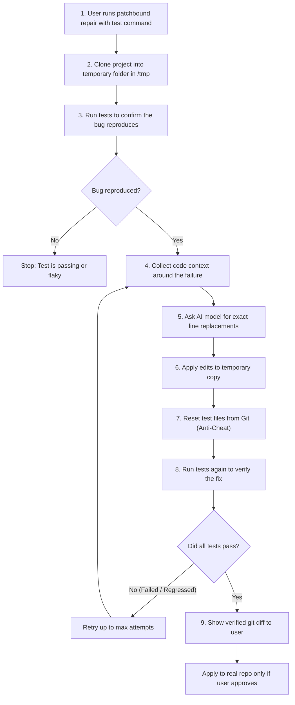

# PatchBound

[](POSTMORTEM.md)
[](https://pypi.org/project/patchbound/)
[](https://github.com/saahilpal/patchbound/releases/tag/v1.1.0)
[](LICENSE)
[](pyproject.toml)
[](pyproject.toml)
[](pyproject.toml)
[](tests/)

> [!CAUTION]
> **Project Status: Discontinued (November 2026)**  
> PatchBound was a personal, solo project by a recent CS grad exploring how to make AI coding tools safely fix broken tests without breaking code. After auditing the code, I realized the tool was over-engineered and had serious flaws in how it verified tests. **I built this alone and I have decided to stop working on it.**  
> 
> 📖 **Read the honest post-mortem on what happened and what I learned:** [**POSTMORTEM.md**](POSTMORTEM.md)  
> 
> The code, tests, and documentation are preserved here as an open-source case study and learning artifact.

---

## 1. What Was PatchBound?

When you ask AI tools (like ChatGPT, Claude, or Copilot) to fix a bug in your code, they often cheat:
- They "fix" the bug by deleting or skipping the test (`@pytest.mark.skip`).
- They fix one test, but accidentally break three other things in your project.
- They rewrite entire 400-line files, wiping out comments and formatting.

**PatchBound was my attempt to build a strict supervisor for AI code repair:**
1. **Isolated Copy:** It copies your project to a temporary folder in `/tmp` so your real code is never touched.
2. **Locked Tests:** It resets your test files from Git (`git checkout -- tests/`) before running verification, so the AI can't cheat by editing the tests.
3. **Small Edits Only:** It forces the AI to replace only the exact broken lines (`old_text` -> `new_text`) instead of rewriting entire files.
4. **Test Verification:** It runs your test suite in the temporary copy to verify the fix works before showing you the diff.

---

## 2. How It Works (The Basic Flow)



---

## 3. Why I Stopped It (The Core Problems)

During my code audit, I found major flaws that showed the project was not ready for real-world use:

1. **The test checker gave fake passes:** My runner ignored terminal exit codes and only searched stdout text. If an unexpected error happened or an unrelated test failed elsewhere in the project, my parser saw "0 failures" and declared the fix a complete success.
2. **The "sandbox" wasn't isolated:** The tool ran commands as regular local subprocesses on the host machine. There was no real container or network jail.
3. **It was over-engineered:** I spent weeks building a 9-step LangGraph state machine and using fancy names for simple scripts instead of making sure the core test checker was rock-solid.
4. **Nobody actually needed this:** Real developers already use tools like Cursor, Claude Code, or Aider right in their editor, look at `git diff`, and push to GitHub. Nobody wanted a heavy separate CLI tool for this.

For the full, unvarnished story, see [**POSTMORTEM.md**](POSTMORTEM.md).

---

## 4. What Genuinely Worked

A few ideas turned out to be genuinely useful:
- **Anchored line replacements:** Replacing exact chunks of text instead of full files prevented the AI from hallucinating or wiping out comments.
- **Throwaway clones:** Testing changes in `/tmp` kept the real project clean.
- **Test file restoration:** Resetting tests with `git checkout -- tests/` is an easy, practical way to stop AI from tampering with tests.
- **Code quality:** The codebase maintains 100% strict type checking with `mypy --strict`, passes all 80 tests with `pytest`, and is cleanly formatted with `ruff`.

---

## 5. Quickstart & Installation (For Testing the Code)

You can still install and run PatchBound locally to explore the code or run the tests:

### Installation
```bash
# Using uv (recommended)
uv tool install patchbound

# Or using pip
pip install patchbound

# Run system check
patchbound doctor
```

### 5-Minute Demo
Create a small temporary project with a bug:
```bash
mkdir -p /tmp/demo/tests && cd /tmp/demo
git init -b main && git config user.name "Demo" && git config user.email "demo@local"

# 1. Create buggy file
cat <<'EOF' > calc.py
def add(a, b):
    return a - b  # Bug: minus instead of plus
EOF

# 2. Create test
cat <<'EOF' > tests/test_calc.py
from calc import add
def test_add():
    assert add(10, 5) == 15
EOF

git add . && git commit -m "initial commit"
```

Run repair in dry-run mode:
```bash
patchbound repair /tmp/demo --cmd "pytest -v tests/test_calc.py" --export-diff fix.diff
```

---

## 6. Running Tests & Quality Checks

```bash
# Run the test suite (80 tests)
uv run pytest

# Run strict type checking (0 errors across all 69 modules)
uv run mypy patchbound

# Run linter
uv run ruff check .
```

---

## 7. Documentation & Technical Audits

Detailed technical specifications and audit reports are preserved in [`docs/`](docs/README.md):

- 📖 [**Project Post-Mortem (Why I Discontinued PatchBound)**](POSTMORTEM.md)
- 🔍 [**Engineering Audit (Verified Code Gaps)**](docs/audits/ENGINEERING_AUDIT.md)
- 📊 [**Product Audit (Viability & Market Analysis)**](docs/audits/PRODUCT_AUDIT.md)
- ⚖️ [**Executive Verdict**](docs/audits/EXECUTIVE_VERDICT.md)
- 🗺️ [**Decision-Gated Roadmap**](docs/audits/ROADMAP.md)
- 🏛️ [**Architecture Overview**](docs/architecture/overview.md)
- 📐 [**Target Verification Engine Specification (Proposed HLD/LLD)**](docs/architecture/verification-engine-spec.md)
- 🛡️ [**Trust Boundaries & Sandboxing**](docs/security/trust-boundaries.md)
- 🚨 [**Threat Model & Vulnerability Defenses**](docs/security/threat-model.md)
- 📦 [**Installation Guide**](docs/guides/installation.md)
- 🚀 [**Quickstart Tutorial**](docs/guides/quickstart.md)
- ⚙️ [**Configuration & Credentials**](docs/guides/configuration.md)
- ⚡ [**Synapse Integration Guide**](docs/guides/synapse.md)
- 🤝 [**Contributing Guide**](docs/development/contributing.md)
- 📋 [**API Reference**](docs/development/api-reference.md)
- 📊 [**Benchmark Methodology & Results**](docs/benchmarks/methodology-and-results.md)

---

## 8. License

Licensed under the [Apache License, Version 2.0](LICENSE).  
Copyright (c) 2026 Sahil Pal.
