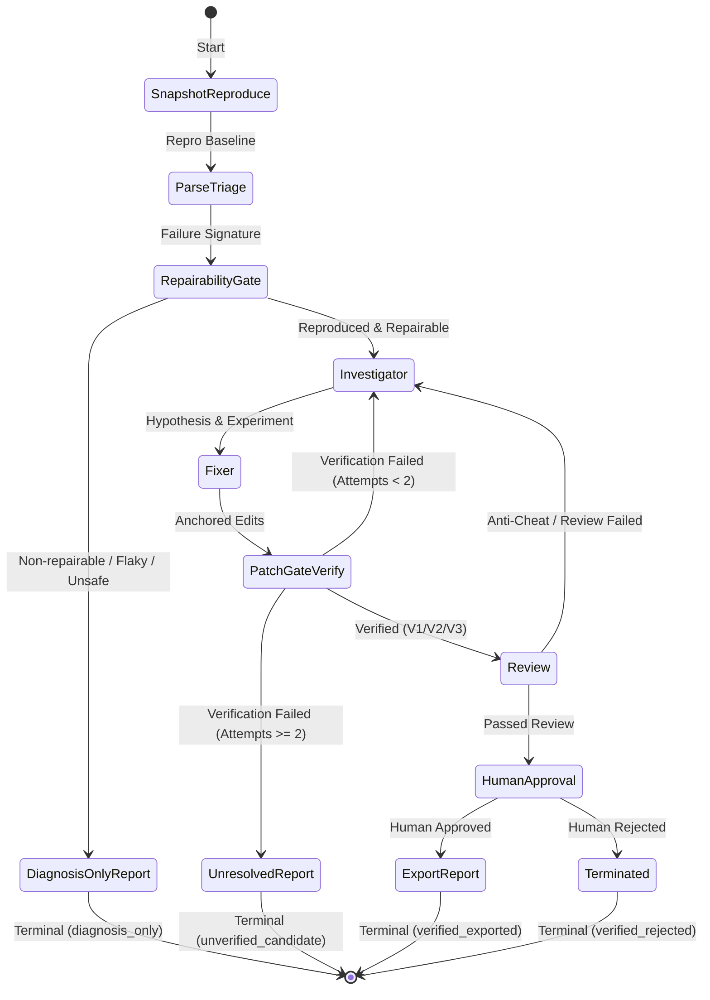

# PatchProof v1.1 LangGraph State Machine Specification

> **Document:** State Management, Transition Semantics & Journaling  
> **Framework:** LangGraph (StateGraph with TypedDict/Pydantic)  
> **Status:** Active

---

## 1. Graph Topology & State Invariants

PatchProof orchestrates its 9 stages using LangGraph. To ensure deterministic execution, crash-resilience, and auditability, the state machine adheres to strict rules:



---

## 2. State Design: Content-Addressed Storage & Reducers

In LangGraph, carrying massive strings (entire git clones, full test logs, large source files) directly inside the state payload causes serialization overhead, state bloat, and memory bottlenecks.

### 2.1 State Contains IDs Only
All bulky objects are written to the **Content-Addressed Storage (CAS)** keyed by `sha256(content)`:
- State holds only lightweight identifiers: `cas_ref_test_output`, `cas_ref_patch`, `cas_ref_diff`.
- The workspace filesystem is a **rebuildable cache**. The single source of truth is `(base_commit, patch_digest)`.

### 2.2 Reducers & Deduplication
Evidence items and experiment logs collected by parallel or sequential nodes are combined using append-only reducers that deduplicate by content hash:

```python
def evidence_reducer(
    existing: list[EvidenceItem], 
    new_items: list[EvidenceItem]
) -> list[EvidenceItem]:
    seen = {item.content_hash for item in existing}
    merged = list(existing)
    for item in new_items:
        if item.content_hash not in seen:
            merged.append(item)
            seen.add(item.content_hash)
    return merged
```

---

## 3. Human Approval Gate & Interrupt Semantics

LangGraph's `interrupt()` primitive pauses graph execution and waits for external human input. However:
> [!IMPORTANT]
> When `interrupt()` resumes, LangGraph re-executes the interrupted node from the beginning.

### Safe Interrupt Protocol
1. **Isolated Node:** The `human_approval` node performs **zero side-effects**. It does not clone repositories, compile code, or modify workspaces.
2. **Idempotency Keys:** Any preceding action that had a side-effect is keyed by `(investigation_id, attempt_index)`. If a step has already executed for that key, it returns cached results immediately.
3. **Cryptographic Binding:** Human approval requires signing the tuple:
$$\text{ApprovalRecord} = \text{HMAC/Signature}\left(\text{PatchDigest} \parallel \text{VerificationHash} \parallel \text{PolicyVersion}\right)$$
4. **Auto-Reverification on Revision:** If the human reviewer submits an edit to the patch, the graph automatically loops back to `PatchGateVerify` rather than approving an unverified human modification.

---

## 4. Status Taxonomy: Process Status vs. Outcome Result

PatchProof cleanly decouples **internal execution state** (process status) from **external business results** (outcome result).

```python
class ProcessStatus(str, Enum):
    INITIALIZING = "initializing"
    REPRODUCING = "reproducing"
    TRIAGING = "triaging"
    INVESTIGATING = "investigating"
    FIXING = "fixing"
    VERIFYING = "verifying"
    REVIEWING = "reviewing"
    AWAITING_APPROVAL = "awaiting_approval"
    EXPORTING = "exporting"
    TERMINATED = "terminated"

class OutcomeResult(str, Enum):
    VERIFIED_EXPORTED = "verified_exported"      # Approved & exported
    VERIFIED_REJECTED = "verified_rejected"      # Verified V1-V3, human rejected
    UNVERIFIED_CANDIDATE = "unverified_candidate"# Candidate generated, verification failed
    DIAGNOSIS_ONLY = "diagnosis_only"            # Clean exit for non-repairable/flaky issues
    NOT_REPRODUCIBLE = "not_reproducible"        # Could not reproduce on base commit
    FLAKY = "flaky"                              # Non-deterministic failure
    BLOCKED_BY_POLICY = "blocked_by_policy"      # Policy constraint violation
    BUDGET_EXHAUSTED = "budget_exhausted"        # Exceeded step/token limits
    ERROR = "error"                              # Infrastructure crash
```

---

## 5. Retry Feedback with Failure Signature Deltas

When verification or review fails, the retry loop does not simply pass the raw error text back to the LLM. Instead, it computes and provides a **Failure Signature Delta**:

```json
{
  "attempt": 1,
  "max_attempts": 2,
  "delta_type": "SECONDARY_ERROR",
  "base_failure": {
    "test_id": "tests/test_parser.py::test_utf8_bom",
    "error_type": "IndexError",
    "message": "list index out of range"
  },
  "current_failure": {
    "test_id": "tests/test_parser.py::test_utf8_bom",
    "error_type": "TypeError",
    "message": "'NoneType' object is not subscriptable"
  },
  "regressions": [
    "tests/test_parser.py::test_ascii_clean"
  ],
  "guidance": "Previous patch resolved IndexError but introduced a TypeError in the same test and broke test_ascii_clean. Must adjust null-handling."
}
```

### Duplicate Detection
To prevent repetitive thrashing:
- The system computes the normalized diff hash of each candidate.
- If a candidate patch produces an identical diff hash or overlapping rejected hunks, it is rejected immediately with a prompt requiring an alternative causal hypothesis.

---

## 6. Audit Journal & OpenTelemetry Spans

Checkpoints are useful for resuming state, but they are **not an audit log**. PatchProof maintains a dedicated append-only, cryptographic audit journal:

1. **Hash-Chained Journal (`journal.jsonl`):**
   - Each event record includes: `timestamp`, `event_type`, `payload`, `prev_record_hash`, `record_hash`.
   - Records every tool invocation, LLM input/output hash, policy evaluation, and user approval.
2. **OpenTelemetry Telemetry:**
   - Traces every stage as an OTel Span.
   - Emits key NFR metrics:
     - `patchproof.stage.duration_ms`
     - `patchproof.llm.tokens.prompt` and `patchproof.llm.tokens.completion`
     - `patchproof.verification.level` (0, 1, 2, 3)
     - `patchproof.cost.usd`
