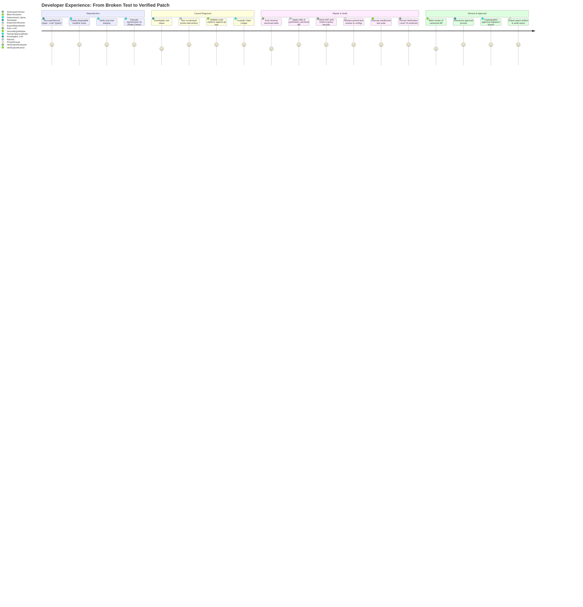
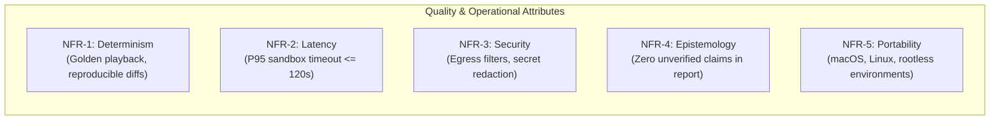
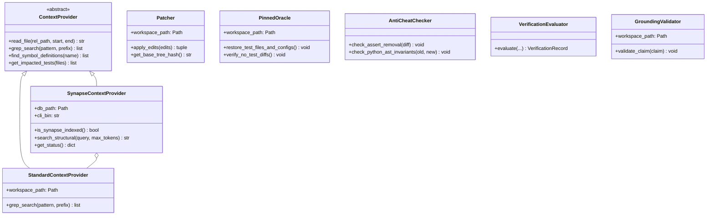
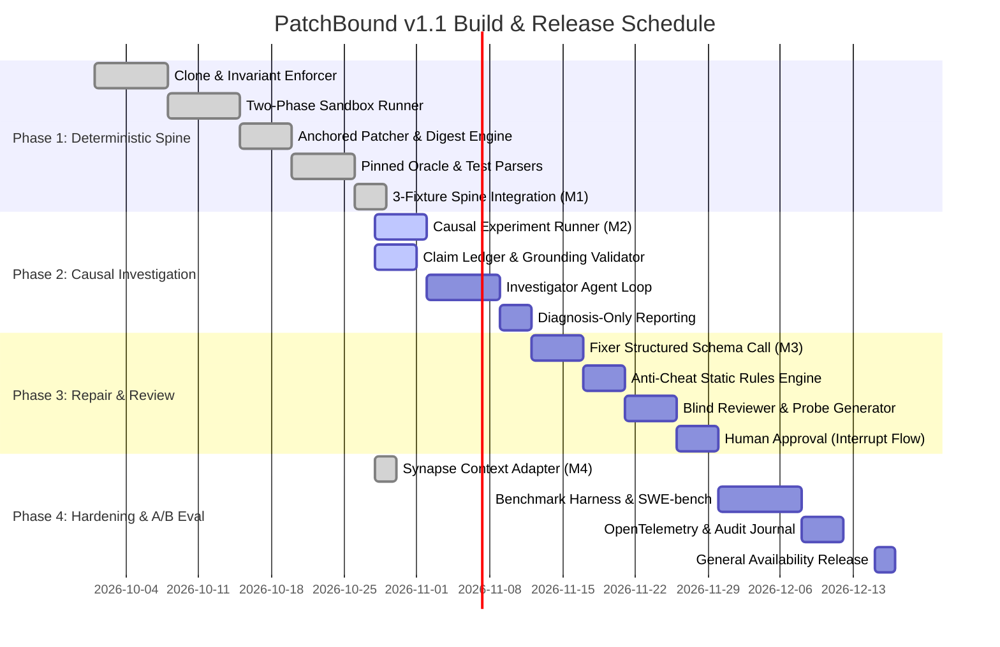

# PatchBound v1.1 Product Requirements Document (PRD)

> **Product Name:** PatchBound  
> **Version:** 1.1.0  
> **Target Release:** Q4 2026  
> **Status:** Approved / Active Specification  
> **Author:** PatchBound Core Architecture & Engineering Team  
> **Audience:** Core Engineers, Security Architects, Platform Leads, Evaluators  

---

## 1. Executive Summary & Market Context

Automated Program Repair (APR) systems powered by Large Language Models (LLMs) represent a quantum leap in developer velocity, yet existing solutions suffer from critical reliability and security failures:
1. **Unbounded Agent Drift:** Multi-agent architectures chain 5 to 10 conversational LLMs, causing context loss, stochastic error compounding, token budget exhaustion, and execution loops.
2. **Oracle Tampering & Anti-Cheat Breaches:** Generative agents frequently "fix" broken test suites by commenting out assertions, deleting test cases, injecting `@pytest.mark.skip`, or mocking test harnesses.
3. **Hallucinated Citations:** When diagnosing root causes, unconstrained models cite nonexistent source files, hallucinated symbol definitions, and fictitious line ranges.
4. **False-Verified Regressions:** Patches claim success after passing a localized unit test while silently breaking downstream components or held-out test suites.

**PatchBound v1.1 inverts this paradigm.** It introduces a **thick deterministic trust boundary** wrapped around **three strictly bounded LLM roles**:
- **Investigator (Single Agent Loop):** Employs read-only tools and interventional scratchpad experiments to produce a verifiable, epistemologically typed **Claim Ledger**.
- **Fixer (Single Structured Call):** Emits an atomic repair plan and exact anchored edits without conversational iteration.
- **Blind Reviewer (Adversarial Audit Call):** Evaluates candidate diffs in clean context without exposure to the fixer's narrative, running probe tests and checking anti-cheat invariants.

An LLM *never* decides whether a fix succeeded. Verification status is mathematically and mechanically derived through sandboxed test runs against pinned test oracles, achieving formal Verification Levels (**V1 to V3**) bound to a cryptographic patch digest:

$$\text{PatchDigest} = \text{SHA-256}(\text{BaseTreeCommit} \parallel \text{CanonicalDiff})$$

---

## 2. Problem Statement & Motivation

### 2.1 The Multi-Agent Failure Mode
Early APR architectures (including PatchBound v1.0 prototypes) treated software repair as a conversational consensus problem among specialized agents (Triage Agent $\to$ Search Agent $\to$ Hypothesis Agent $\to$ Coder Agent $\to$ Reviewer Agent). In practice:
- **Token Velocity Inflation:** Conversations exceeded $250{,}000$ tokens per bug without converging.
- **Host Contamination:** LLM-generated bash commands polluted local file systems, left orphaned background processes, and mutated host git branches.
- **Flaky Conflation:** Systems spent dozens of iterations attempting to repair non-deterministic or unparseable test failures that were fundamentally unrepairable.

### 2.2 Core Product Thesis
A production-grade automated repair engine must treat LLMs as untrusted hypothesis generators, delegating all verification, git manipulation, test execution, policy enforcement, and audit trail maintenance to deterministic code.

---

## 3. Product Vision & Success Metrics (OKRs & KPIs)

### 3.1 Vision
Deliver an autonomous software repair engine that developers and security teams can trust with mission-critical repositories—guaranteeing that every generated patch is mechanically verified, cryptographically audited, and incapable of gaming test suites.

### 3.2 Primary Safety Metric: False-Verified Rate ($FVR$)
The primary metric governing system safety is the held-out failure rate of patches verified at Levels V1–V3:

$$FVR = \frac{\text{Patches Verified at V1-V3 that Fail Held-Out Evaluation Suites}}{\text{Total Verified Patches}}$$

- **Target:** $\mathbf{FVR < 1.0\%}$ (calculated with $95\%$ Wilson score confidence intervals).

### 3.3 Key Operational Metrics & Targets

| Metric | Target | Verification Method |
| :--- | :--- | :--- |
| **First-Pass Verification Rate** | $> 65\%$ | Percentage of verified patches succeeding on Attempt 0 without retries. |
| **Abstention Precision** | $> 95\%$ | Precision in classifying unrepairable/flaky bugs as `diagnosis_only` without wasting fix tokens. |
| **Abstention Recall** | $> 90\%$ | Correctly identifying non-reproducible bugs before invoking fixer models. |
| **Retry Convergence Rate** | $> 50\%$ | Successful repair on Attempt 1 or 2 when guided by structured Failure Deltas. |
| **Mean Cost Per Fix** | $< \$0.15$ USD | Total model token + inference expenditure per successfully verified patch. |
| **Anti-Cheat Enforcement** | $100\%$ detection | Absolute rejection of assert deletion, test skipping, and protected config mutation. |
| **Host Invariant Preservation** | $100\%$ zero mutation | Cryptographic hash identity of host repository state pre-run vs post-run. |

---

## 4. User Personas & Core Workflows

### 4.1 Personas
1. **Core Software Engineer (Local Developer):**
   - *Need:* Rapidly diagnose and propose fixes for localized test regressions without manual context gathering or debugging loops.
   - *Workflow:* Runs `patchbound diagnose` or `patchbound repair` from the terminal; inspects rich terminal UI diffs and verification badges.
2. **CI/CD Platform & Release Engineer:**
   - *Need:* Automated headless triage in CI workflows; runs unattended benchmarks on pull requests.
   - *Workflow:* Integrates headless runner, ingests structured JSON audit logs, and gates PR approval on cryptographic verification hashes.
3. **Security & Compliance Auditor:**
   - *Need:* Absolute guarantee that automated AI fixes do not leak credentials, bypass safety policies, or touch sensitive infrastructure.
   - *Workflow:* Audits the hash-chained, append-only cryptographic event journal and Claim Ledger citations.

### 4.2 Primary Use Cases

---

## 5. Functional Requirements (FRs)

### 5.1 Deterministic Spine & Isolation (Stages 1, 2, 3)
- **FR-1.1 (Disposable Cloning):** The engine shall create disposable working directories using local hardlinked git clones (`git clone --local -c core.hooksPath=/dev/null`). Host repository working trees, branch pointers, and index states shall never be modified.
- **FR-1.2 (Host Invariant Enforcement):** The engine shall compute a SHA-256 fingerprint of the host repository pre-run and post-run (`git rev-parse HEAD`, `git show-ref`, `git status --porcelain`). Execution shall abort with `HostIntegrityViolation` if any mutation is detected.
- **FR-1.3 (Two-Phase Sandboxing):** Test and build execution shall run in an isolated subprocess environment:
  - *Prepare Phase:* Network outbound allowed strictly to verified mirrors/lockfiles for dependency installation.
  - *Execute Phase:* Process sandboxing with scrubbed environments (`PATH`, `HOME`, `PYTHONPATH`), execution timeouts, and zero outbound network egress.
- **FR-1.4 (Deterministic Triage & Classification):** The engine shall execute the user-specified reproduction command 3 times to classify failure behavior into mutually exclusive states:
  - `reproduced`: Fails consistently across all runs.
  - `flaky`: Inconsistent pass/fail outcomes across 3 runs.
  - `not_reproducible`: Test passes in all 3 runs.
- **FR-1.5 (Repairability Gate):** Non-reproducible and flaky bugs shall immediately transition to `OutcomeResult.NOT_REPRODUCIBLE` or `OutcomeResult.FLAKY`, generating a Diagnosis-Only Report without expending tokens on repair attempts.

### 5.2 Causal Investigation & Epistemological Claim Ledger (Stage 4)
- **FR-2.1 (Epistemological Claim Taxonomy):** All statements generated during diagnosis shall be categorized into typed claim items:
  - `OBSERVED`: Ground-truth facts extracted directly from sandboxed test execution (e.g. stack frames, error types, test IDs).
  - `DERIVED`: Deterministic computations over observed facts (e.g. `git blame`, AST imports, diff hunks).
  - `INFERRED`: Hypotheses corroborated by an interventional scratchpad experiment.
  - `ASSUMED`: Unverified heuristics (flagged with explicit warnings in audit reports).
- **FR-2.2 (Cryptographic Citation Validator):** Every code citation attached to a claim shall specify `(tree_hash, file_path, line_start, line_end, exact_quote)`. The engine shall verify citations via `git cat-file -p {tree_hash}:{file_path}`. Quoted text that does not match reality shall raise `CitationFabricationError` and be excluded from the ledger.
- **FR-2.3 (Interventional Scratchpad Experiments):** The engine shall provide an `ExperimentRunner` capable of applying temporary probe hunks in ephemeral scratch workspaces to empirically validate or refute hypotheses before synthesizing production repairs.
- **FR-2.4 (Bounded Investigator Loop):** The investigator node shall be strictly bounded by step budgets (default: 12 steps) and token budgets (default: 150,000 tokens).

### 5.3 Repair Synthesis & Anchored Patching (Stage 5)
- **FR-3.1 (Single Structured Call):** The Fixer shall synthesize repairs in a single structured LLM call emitting:
  1. A concise, causal repair plan addressing the validated root cause.
  2. A sequence of atomic `AnchoredEdit` objects: `(file_path, old_text, new_text)`.
- **FR-3.2 (Ambiguity Rejection):** `AnchoredEdit` replacement shall require exact string matching. If `old_text` matches 0 times or $>1$ time in the target file, patch application shall immediately fail with `PatchApplicationError`.
- **FR-3.3 (Canonical Diff Generation):** Edits shall be converted into canonical git diffs (`git diff --no-prefix -U3`) and bound to a 64-character SHA-256 patch digest.

### 5.4 Deterministic Verification & Anti-Cheat (Stage 6)
- **FR-4.1 (Pinned Test Oracle Restoration):** Before running verification tests, the engine shall forcibly restore all test files and build configuration files (`tests/`, `test/`, `pytest.ini`, `conftest.py`, `package.json`, etc.) to their base `HEAD` commit via `git checkout HEAD --`.
- **FR-4.2 (Oracle Tampering Detection):** If `git diff --name-only HEAD` detects any modified files inside test paths or protected config lists, verification shall fail with `PolicyViolation`.
- **FR-4.3 (Static Anti-Cheat Checker):** The engine shall parse diffs and Python ASTs to detect cheating patterns:
  - Deletion of `assert` statements.
  - Introduction of test skipping decorators (`@pytest.mark.skip`, `@unittest.skip`, `it.skip`).
  - Suppression of linter/typechecker errors (`# type: ignore`, `# noqa`, `/* eslint-disable */`).
- **FR-4.4 (Formal Verification Levels):** Test results shall be classified into formal tiers:
  - **Level V0 (Failed):** F2P tests still fail, P2P tests regress, or fewer tests run than baseline.
  - **Level V1 (Target Verified):** Target failing tests (F2P) pass cleanly.
  - **Level V2 (Impact Verified):** V1 achieved + all impacted passing tests (P2P) pass.
  - **Level V3 (CI Clean):** V2 achieved + full reproduction test suite passes with zero failures.

### 5.5 Adversarial Review & Human Approval (Stages 7 & 8)
- **FR-5.1 (Blind Reviewer):** The candidate patch diff shall be passed to an independent model in a clean context window (without the fixer's explanation or prompt rationale). The reviewer must summarize patch intent, verify alignment with the failure signature, and flag suspicious patterns.
- **FR-5.2 (Human Gate with Cryptographic Binding):** The workflow shall yield at an interactive approval gate (`human_approval`). Human approval shall compute an immutable signature bound to:
  
  $$\text{ApprovalSignature} = \text{SHA-256}(\text{"APPROVED"} \parallel \text{PatchDigest} \parallel \text{VerificationHash} \parallel \text{PolicyVersion})$$

### 5.6 Context Providers & Structural Intelligence
- **FR-6.1 (Dual Context Provider Architecture):** The system shall support pluggable context providers implementing the common `ContextProvider` contract:
  - `StandardContextProvider`: Baseline Unix/git primitives (extended regex grep, AST definitions, file reading).
  - `SynapseContextProvider`: Native structural code graph engine querying Synapse SQLite databases (`.synap/synap.db`) and the `synap` CLI for instant AST definition lookups and reverse dependency call-edge test impact analysis.
- **FR-6.2 (Seamless Fallback):** When running against unindexed scratchpads or repositories where Synapse is absent, `SynapseContextProvider` shall automatically fall back to standard primitives without crashing.

### 5.7 Audit Trail & Telemetry (Stage 9)
- **FR-7.1 (Cryptographic Audit Journal):** The engine shall record every pipeline event in an immutable, hash-chained journal:
  
  $$\text{EntryHash}_n = \text{SHA-256}(\text{Timestamp} \parallel \text{EventType} \parallel \text{Payload} \parallel \text{EntryHash}_{n-1})$$

- **FR-7.2 (OpenTelemetry Metrics):** Pipeline stages shall emit OpenTelemetry spans with duration, token expenditure, and verification outcomes for centralized observability.

---

## 6. Non-Functional Requirements (NFRs)

- **NFR-1 (Determinism & Offline Replay):** The system shall support a complete offline playback mode via `LLMRecorder`, enabling 100% deterministic regression test runs without calling live LLM APIs.
- **NFR-2 (Execution Latency & Timeouts):** Individual test executions shall be bounded by strict timeouts (default: 120 seconds per test command). Deterministic spine operations (cloning, hashing, anti-cheat AST parsing) must complete in $<500\text{ms}$.
- **NFR-3 (Egress Security & Secret Scrubbing):** The LLM gateway and postflight export checks shall sanitize all outbound prompts and diffs, stripping AWS access keys, GitHub tokens, private keys, and environment passwords via `EgressGate`.
- **NFR-4 (Sandboxed Process Isolation):** Commands executed during reproduction, experiment interventions, and verification shall run with sanitized environment variables, preventing secret leakage from host `.env` files or shells.
- **NFR-5 (Cross-Platform CLI Compatibility):** The codebase shall support Python 3.11+ across macOS (Apple Silicon / Intel) and standard Linux distributions (Ubuntu, Debian, RHEL) under both direct CLI and containerized execution.

---

## 7. Technical Architecture & Component Interaction

---

## 8. Benchmark Evaluation & Statistical Validation

To empirically validate performance, PatchBound v1.1 embeds a statistical evaluation framework:
1. **Paired-Arm Evaluation (`BenchmarkRunner`):** Every benchmark dataset is evaluated across comparative arms (`standard-context` vs `synapse-context`, `unbounded-agent` vs `deterministic-spine`) against the exact same commit and environment seed.
2. **Synthetic Bug Mutator (`SyntheticMutator`):** Automatically injects AST mutations (operator swaps, off-by-one boundary flips, boolean inversion) into clean codebases, runs tests to verify test failure flipping, and measures system recovery rates.
3. **Statistical Confidence:** All metric summaries calculate 95% confidence intervals using the Wilson score interval:

$$w = \frac{\hat{p} + \frac{z^2}{2n} \pm z \sqrt{\frac{\hat{p}(1-\hat{p})}{n} + \frac{z^2}{4n^2}}}{1 + \frac{z^2}{n}}$$

---

## 9. Phased Implementation Roadmap

---

## 10. Explicit Non-Goals & Deferrals

To maintain high engineering velocity and prevent architectural scope creep, the following capabilities are **explicitly deferred** past v1.1:

| Deferred Capability | Justification | Target Milestone |
| :--- | :--- | :--- |
| **Parallel Candidate Branches** | v1.1 evaluates linear candidates sequentially with failure deltas to conserve token budgets. | v1.2 |
| **GitHub Actions / Webhook Daemon** | PatchBound is designed as an engine / CLI first. Webhook ingestion is external plumbing. | v1.2 |
| **Direct Git Push / PR Merging** | Safety first: PatchBound emits an approved patch artifact and digest; downstream CI handles repository pushes. | v1.2 |
| **Interactive Web UI** | Rich terminal UI (`rich` / CLI) and audited markdown reports provide superior developer transparency. | v2.0 |
| **Historical Bug Memory / Vector RAG** | In-context causal investigation and AST symbol navigation are vastly more accurate than fuzzy retrieval over stale bug databases. | v2.0 |

---

## 11. Technical Risk Matrix & Mitigations

| Risk | Probability | Impact | Mitigation Strategy |
| :--- | :---: | :---: | :--- |
| **Host Repository Corruption** | Low | Critical | Local hardlink cloning with hooks disabled; cryptographic pre/post host invariant checks abort execution on any mutation. |
| **Infinite Verification Loops** | Medium | High | Hardcoded maximum retry caps (`attempt < max_attempts`) enforced by LangGraph conditional edge routing. |
| **LLM Citation Hallucination** | High | High | `GroundingValidator` validates file existence and exact line quotes via `git cat-file` before appending to Claim Ledger. |
| **Secret Leaks in Emitted Diffs** | Medium | Critical | `EgressGate` regex and entropy scanners filter AWS keys, tokens, and credentials in both preflight prompts and postflight diffs. |
| **Flaky Test Conflation** | High | Medium | Baseline 3x reproduction run automatically classifies non-deterministic tests and abstains early via `RepairabilityGate`. |
| **Anti-Cheat Evasion** | Medium | High | Combined diff inspection and Python AST invariant checks detecting deleted `assert` statements and test skip decorators. |
| **Dependency Missing in Sandbox** | Low | Medium | Strict virtual environment enforcement via `uv`, isolated sandbox `PYTHONPATH`, and two-phase install preparation. |
