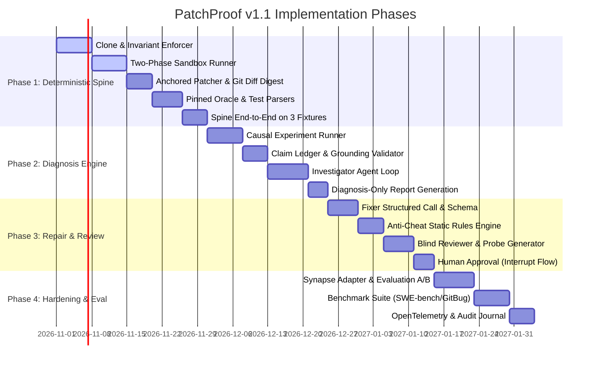

# PatchProof v1.1 Engineering Roadmap & Build Order

> **Version:** 1.1.0  
> **Target Release:** Q4 2026  
> **Status:** Execution Ready

---

## 1. Guiding Principles & Strategy

Building an automated program repair system is fraught with premature agent complexity. The highest technical risks in PatchProof reside in the **deterministic trust boundary**:
1. Sandbox isolation and reproducible test execution.
2. Robust parsing and failure signature generation.
3. Anchored patch application without whitespace/offset decay.
4. Oracle pinning to prevent test tampering.
5. Strict, tamper-proof audit trails.

Therefore, our engineering roadmap strictly mandates: **Build the deterministic spine first with recorded/fake LLM fixtures before writing a single production LLM prompt.** The LLM nodes are pluggable components that slot into a rigid, battle-tested execution harness.

---

## 2. Phased Build Order

### Phase 1: The Deterministic Spine (Milestone: M1)
**Objective:** Execute the complete end-to-end graph on 3 reproducible fixtures using deterministic mock/recorded LLM outputs.

- **Deliverables:**
  - `patchproof.core.clone`: Local disposable clone engine with pre/post hash invariant verification.
  - `patchproof.core.sandbox`: Two-phase sandbox interface (`Prepare` with mirror/lockfile cache; `Execute` with network/rlimit isolation).
  - `patchproof.core.patcher`: Anchored edit parser and canonical `git diff` synthesis.
  - `patchproof.core.digest`: Cryptographic patch digest generator: $\text{SHA-256}(\text{base\_tree} \parallel \text{canonical\_diff})$.
  - `patchproof.core.policy`: Unified policy file loader (`policy.yaml`) checking paths, diff sizes, and command templates.
  - `patchproof.verification.oracle`: Hash-based test & config restoration engine.
  - `patchproof.verification.parsers`: Deterministic JUnit, Pytest, and Jest/Vitest structured log parsers.
  - `patchproof.verification.levels`: Formal evaluator for levels V1, V2, and V3.
  - **Spine Integration Test:** Verify 3 real failure fixtures (Python pytest bug, TypeScript vitest bug, syntax/linter failure) from clone $\to$ triage $\to$ mock fix $\to$ verification $\to$ export.

### Phase 2: Causal Investigation & Claim Ledger (Milestone: M2)
**Objective:** Deliver high-confidence, interventional root-cause analysis without hallucinated citations.

- **Deliverables:**
  - `patchproof.ledger.experiment`: Scratchpad experiment runner for hypothesis testing (probe injection, hunk revert).
  - `patchproof.ledger.claim`: Typed claim models (`observed`, `derived`, `inferred`, `assumed`).
  - `patchproof.ledger.validator`: Cryptographic citation validator verifying that quoted lines and symbols exist at base tree commit.
  - `patchproof.llm.gateway`: Role-tiered LLM gateway with hard token, cost, and timeout budgets.
  - `patchproof.llm.recorder`: Golden file recording/playback harness for deterministic regression testing.
  - `patchproof.graph.nodes.investigator`: The bounded LLM agent loop with read-only tools and scratch experiments.
  - **Outcome:** System produces comprehensive, grounded **Diagnosis-Only Reports** for non-repairable and out-of-scope issues.

### Phase 3: The Repair & Adversarial Review Loop (Milestone: M3)
**Objective:** Synthesize verified patches and subject them to blind counter-examination.

- **Deliverables:**
  - `patchproof.graph.nodes.fixer`: Single structured LLM call emitting repair plan + anchored edits.
  - `patchproof.core.anti_cheat`: Deterministic static analyzer detecting assertion stripping, test skip flags, and lint ignores.
  - `patchproof.graph.nodes.review`: Blind Reviewer evaluating canonical diff in isolated context and submitting executable probe tests.
  - `patchproof.graph.nodes.human_approval`: LangGraph `interrupt()` node binding approval signature to `(patch_digest, verification_hash, policy_version)`.
  - Retry logic emitting failure signature deltas on failed verification (bounded to 2 retries).

### Phase 4: Context Providers, Evaluation & Production Hardening (Milestone: M4)
**Objective:** Run rigorous benchmark evaluation and assess standard primitives vs Synapse context provider.

- **Deliverables:**
  - `patchproof.context.standard`: Baseline context provider (ripgrep, ctags, AST symbol lookup, git log).
  - `patchproof.context.synapse`: Synapse adapter (CLI, MCP, or in-process) implementing the common context contract.
  - `patchproof.audit.journal`: Hash-chained append-only event journal.
  - `patchproof.audit.metrics`: OpenTelemetry exporter for NFR-10 metrics (latency, token cost, verification rate).
  - Benchmark evaluation suite on SWE-bench / GitBug-Actions / private repo bug injections.

---

## 3. Explicit Deferrals & Non-Goals

To maintain high engineering velocity and avoid scope creep, the following items are **explicitly deferred** past v1.1:

| Deferred Capability | Justification | Future Target |
| :--- | :--- | :--- |
| **Parallel Candidate Patches** | Architecture supports 1 workspace per candidate; v1.1 ships with 1 linear candidate to optimize cost and token consumption. | v1.2 |
| **GitHub Actions / Webhook Daemon** | PatchProof runs as a high-performance CLI / local engine first. Webhook ingestion is external plumbing. | v1.2 |
| **Interactive Web UI** | Terminal UI (`rich` / CLI) and markdown/JSON reports provide superior visibility for developers. | v2.0 |
| **Historical Bug Memory / Vector RAG** | In-context investigation and code analysis are far more accurate than fuzzy retrieval over stale bug databases. | v2.0 |
| **Direct Branch Push / PR Merging** | Safety first: PatchProof emits an approved patch artifact and digest; downstream CI/CD handles repository pushes. | v1.2 |

---

## 4. Falsifiable Hypotheses & Evaluation Metrics

We do not make architectural changes on intuition. The v1.1 design will be evaluated against measurable criteria:

### Primary Safety Metric: False-Verified Rate ($FVR$)
$$FVR = \frac{\text{Patches Verified at V1-V3 that fail held-out test suite}}{\text{Total Verified Patches}}$$
*Target:* $\mathbf{FVR < 1.0\%}$ on held-out evaluation suites.

### Operational Metrics
1. **Abstention Quality:** Accuracy of the Repairability Gate in correctly classifying unrepairable, flaky, or out-of-scope issues as `diagnosis_only` without wasting fix tokens. Target: $>95\%$ precision.
2. **First-Pass Verification Rate:** Percentage of patches achieving V1-V3 on Attempt 1.
3. **Retry Convergence Rate:** Percentage of retries that succeed given a failure signature delta.
4. **Cost Per Verified Fix:** Average LLM token + inference cost per successfully verified patch.
5. **Standard vs. Synapse Delta:** A/B benchmark measuring whether structural graph context improves first-pass verification rate or reduces token consumption relative to standard ripgrep/AST primitives.
