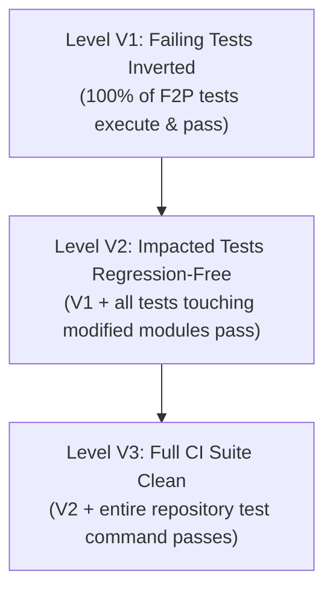

# PatchProof v1.1 Verification Engine & Claim Ledger

> **Document:** Verification Mechanics & Causal Grounding Specification  
> **Classification:** Core Technical Standard  
> **Status:** Active

---

## 1. Reproduce-First Principle

In automated software repair, **there is no oracle without a confirmed reproduction**. Traditional repair frameworks attempt to generate a fix before verifying whether the failure can be cleanly reproduced on the base snapshot.

PatchProof enforces reproduction as **Stage 1**:
1. At the base commit $C_0$, the runner executes the user's reproduction command $N$ times (default $N = 3$).
2. The outcomes are classified deterministically:

| Baseline Classification | Definition | Pipeline Routing |
| :--- | :--- | :--- |
| **`reproduced`** | Failure reproduced reliably across runs with identical failure signature. | **Proceeds to Stage 2 (Parse & Triage) and repair.** |
| **`flaky`** | Test intermittently passes and fails across the $N$ baseline runs. | **Terminates at Stage 3 Repairability Gate $\to$ Diagnosis Report.** |
| **`not_reproducible`** | Command exits 0 (all tests pass) on the base commit. | **Terminates at Stage 3 Repairability Gate $\to$ Diagnosis Report.** |
| **`env_mismatch`** | Missing system headers, incompatible Node/Python runtime, or host environment error. | **Terminates at Stage 3 Repairability Gate $\to$ Diagnosis Report.** |

> [!NOTE]
> Terminating with a **Diagnosis-Only Report** is an operational **success**, not a failure. It prevents the system from generating hallucinatory patches for tests that were never broken or whose failures are non-deterministic.

---

## 2. Test Suites: Fail-to-Pass (F2P) & Pass-to-Pass (P2P)

Borrowing the rigorous methodology of SWE-bench:
- **Fail-to-Pass (F2P) Tests:** The minimal subset of test IDs that failed during Stage 1 baseline reproduction. These specific tests *must* flip from `FAILED` to `PASSED`.
- **Pass-to-Pass (P2P) Tests:** Tests in the test suite that passed during the baseline run. These tests *must not regress*.
- **Failure Signature:** Each failure is fingerprinted as:
$$\text{Signature} = \left(\text{TestID}, \text{ErrorType}, \text{NormalizedMessage}, \text{TopStackFrame}\right)$$

If an attempted patch results in the F2P test failing with a *different* error message or stack frame, PatchProof classifies this as **Progress** or **Secondary Error**, but never "Fixed".

---

## 3. Verification Levels (V1, V2, V3) & Quality Flags

Verification is never represented as a single boolean. Instead, PatchProof computes a hierarchical verification level:



### Verification Criteria

| Level | Name | Precise Verification Criteria |
| :--- | :--- | :--- |
| **V1** | **Target Fixed** | Every test ID in the F2P set is reported as `executed` and `passed` in the parsed JUnit/JSON report. Zero F2P tests skipped. |
| **V2** | **Impact Clean** | V1 is satisfied, plus all test files identified by dependency analysis (or reverse dependency graph) as importing modified files pass. |
| **V3** | **CI Clean** | V2 is satisfied, plus the repository's full CI test command runs to completion with zero test failures and zero test regressions. |

### Orthogonal Verification Flags
Alongside the level, the verification record carries strict boolean verification flags:
- `flake-checked`: Repro command executed $N \ge 3$ consecutive times post-patch with zero failures.
- `pinned-tests`: Original test files, test fixtures, and config files were verified intact via SHA-256 before the test run.
- `policy-clean`: The patch contains no disallowed skip markers, linter suppressions, or assertion deletions.

---

## 4. Structured Results Only (Anti-Zero-Run Defense)

Naive repair tools check only the process exit code (`exit 0`). This leaves them vulnerable to:
1. Early test exit or fatal unhandled error in teardown masked as 0.
2. Zero tests matched (e.g., `-k` filter typo matching 0 tests and exiting 0).
3. Test suite deselected or tests marked `@skip`.

**PatchProof Verification Invariants:**
- Test results are parsed exclusively from structured XML/JSON reports (`pytest-json-report`, JUnit XML, Vitest JSON).
- The executed test count must satisfy:
$$\text{Count}(\text{Executed}_{\text{patched}}) \ge \text{Count}(\text{Executed}_{\text{baseline}})$$
- The skipped test count must satisfy:
$$\text{Count}(\text{Skipped}_{\text{patched}}) \le \text{Count}(\text{Skipped}_{\text{baseline}})$$
- Every single test ID in F2P must be explicitly found in the report with status `PASSED`.

---

## 5. Interventional Causality & Scratch Experiments

A plausible explanation generated by an LLM is not evidence of causality. Before proposing a patch, the **Investigator** must substantiate hypotheses with **interventional experiments**:

```
Investigator Loop:
  1. Hypothesis: "Line 42 in utils.py fails because input_val is None when flag=False"
  2. Prediction: "Injecting an early return `if input_val is None: return 0` will turn test_edge_case() from FAIL to PASS."
  3. Action: ExperimentRunner applies minimal probe in scratch workspace.
  4. Execution: Runs test_edge_case() inside sandbox.
  5. Result:
       - Supported: Test flipped to PASS -> Evidence recorded.
       - Refuted: Test still FAIL or raised TypeError -> Hypothesis discarded.
```

Only hypotheses backed by at least one interventional confirmation are flagged as `high_confidence`.

---

## 6. The Cryptographic Claim Ledger

The final investigation report is rendered directly from a structured **Claim Ledger**:

### Claim Taxonomy
- `observed`: Direct empirical data extracted by deterministic code (e.g., raw test failure message, bisect commit hash, file size).
- `derived`: Deterministic computation over observed facts (e.g., test duration diff, git blame author).
- `inferred`: Deductions drawn by the LLM that are corroborated by interventional experiments.
- `assumed`: Unsubstantiated hypotheses (explicitly marked with warnings in the report).

### Claim Schema
```json
{
  "claim_id": "CLM-004",
  "claim_type": "inferred",
  "statement": "Missing check for empty string in parse_token() results in IndexError at line 58.",
  "evidence_ids": ["EV-012", "EXP-003"],
  "confidence": "high",
  "citations": [
    {
      "file_path": "src/parser/tokenizer.py",
      "line_start": 56,
      "line_end": 60,
      "tree_hash": "e83b2f8a1...",
      "exact_quote": "token = raw_tokens[0]"
    }
  ]
}
```

### Deterministic Grounding Validator
Before generating reports, the Grounding Validator performs mechanical checks:
1. Every `evidence_id` referenced must exist in the run's immutable CAS journal.
2. For each citation, the `file_path` must exist at the target `tree_hash`.
3. The `exact_quote` string must exist verbatim at `line_start..line_end`. If the model fabricates code that does not exist in the repository, the claim validator flags a `CITATION_FABRICATION_ERROR`.
