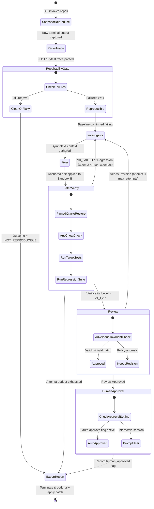

# LangGraph State Machine & Orchestration — PatchBound v1.1.0

**Document:** Orchestration & State Flow Specification  
**Status:** Approved & Verified (v1.1.0)  
**Index:** [Architecture Overview](overview.md) • [State Machine](orchestration.md) • [Context Providers](context-providers.md) • [Verification Design](verification.md) • [Trade-Offs](tradeoffs.md)

---

## 1. State Machine Topology & Transition Flow

PatchBound coordinates repair investigations as a bounded, acyclic-by-default state machine managed by LangGraph. Retries are strictly counter-bounded by `max_attempts` (default: 2 retries, total 3 executions).

---

## 2. State Schema (`PatchBoundState`)

All nodes read from and write to a single typed dictionary, `PatchBoundState`:

| Field Name | Type | Description |
| :--- | :--- | :--- |
| `investigation_id` | `str` | Unique UUID tracking the investigation across scratch sandboxes. |
| `repo_path` | `str` | Absolute path to target host repository. |
| `reproduce_cmd` | `list[str]` | The command used to deterministically reproduce the failure (e.g. `["pytest", "tests/test_calc.py"]`). |
| `attempt` | `int` | Current loop retry counter (starts at 0). |
| `max_attempts` | `int` | Maximum loop attempts permitted before terminating with `BUDGET_EXHAUSTED`. |
| `status` | `ProcessStatus` | Lifecycle status (`INITIALIZING`, `INVESTIGATING`, `FIXING`, `VERIFYING`, `TERMINATED`). |
| `outcome` | `OutcomeResult` | Terminal classification (`VERIFIED_EXPORTED`, `NOT_REPRODUCIBLE`, `BUDGET_EXHAUSTED`, `REJECTED_BY_USER`). |
| `raw_reproduce_output` | `str` | Unprocessed stdout/stderr from baseline execution. |
| `active_failure_signature`| `FailureSignature` | Parsed failure metadata (exception type, error message, stack trace lines). |
| `f2p_test_ids` | `list[str]` | Fail-to-Pass target test identifiers. |
| `p2p_baseline_passes` | `list[str]` | Tests that passed in the clean baseline and must remain passing. |
| `target_file` | `str` | Inferred file path containing the defect. |
| `target_symbol` | `str` | Inferred function, method, or class name. |
| `code_context` | `str` | AST source lines and call-graph context gathered by the investigator. |
| `hypotheses` | `list[str]` | Hypotheses formulated to explain the failure. |
| `repair_plan` | `str` | Natural language repair strategy synthesized by the fixer. |
| `anchored_edits` | `list[AnchoredEdit]` | Exact `(file_path, old_text, new_text)` replacement tuples. |
| `verification_record` | `VerificationRecord`| Detailed test execution record across V1, V2, and V3 levels. |
| `failure_delta` | `FailureDelta` | Structured feedback passed to the investigator if a previous attempt failed. |
| `review_status` | `str` | Approval status from the adversarial review node (`"approved"` or `"rejected"`). |
| `human_approved` | `bool` | Explicit human approval status prior to host patch application. |

---

## 3. Node Responsibilities & Routing Logic

### Stage 1: `snapshot_reproduce`
- Creates disposable Sandbox A (`/tmp/patchbound-workspaces/<id>/attempt-0`).
- Executes `reproduce_cmd` in the clean baseline.
- Records exit code, stdout, and stderr.

### Stage 2: `parse_triage`
- Invokes `PytestOutputParser` or `JUnitParser` to extract structured test failures.
- Normalizes failure signatures (removes memory addresses, line variances, and nondeterministic timestamps).

### Stage 3: `repairability_gate`
- **Invariant:** If baseline execution resulted in 0 test failures, the issue is classified as `NOT_REPRODUCIBLE`. Execution routes directly to `export_report`, avoiding all LLM spend.

### Stage 4: `investigator`
- Resolves context provider mode (`auto`, `synapse`, or `standard`).
- Queries file tree, Git diff, and AST symbol tables.
- If a previous attempt produced a `failure_delta` (e.g. `REGRESSION` or `SAME_FAILURE`), adjusts search coordinates.

### Stage 5: `fixer`
- Synthesizes anchored replacement blocks (`AnchoredEdit`).
- If cloud API keys are provisioned, dispatches to `LLMGateway`.
- If offline, executes deterministic heuristic repairs and evolves previous edits.

### Stage 6: `patch_verify`
- Creates Sandbox B.
- Applies anchored edits via `Patcher`.
- Executes pinned oracle restoration (`git checkout -- tests/`).
- Runs AST anti-cheat scanner.
- Executes target tests (asserting Fail-to-Pass).
- Executes baseline regression suite (asserting Pass-to-Pass).
- Scored against `VerificationLevel` (`V0_FAILED`, `V1_F2P`, `V2_P2P`, `V3_CI_CLEAN`).

### Stage 7: `review`
- Performs blind secondary verification checking for oversized hunks or policy violations.

### Stage 8: `human_approval`
- Evaluates `auto_approve` setting. If interactive and not auto-approved, pauses for explicit operator signoff.

### Stage 9: `export_report`
- Writes `.diff` patch artifact to disk.
- Appends cryptographic SHA-256 entry to audit journal.
- If `--apply` was requested and `human_approved` is `True`, applies patch to host repository.
