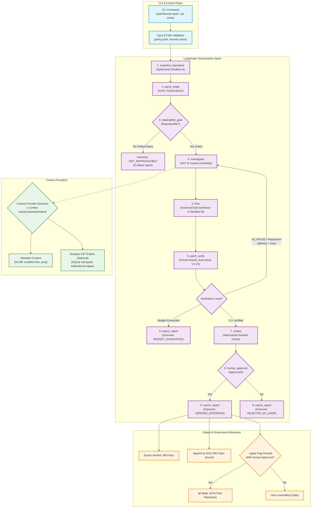

# Architecture Overview — PatchBound v1.1.0

**Document:** Architecture Overview & System Topology  
**Status:** Approved & Verified (v1.1.0)  
**Index:** [Architecture Index](overview.md) • [State Machine](orchestration.md) • [Context Providers](context-providers.md) • [Verification Design](verification.md) • [Trade-Offs](tradeoffs.md)

---

## 1. High-Level System Architecture

PatchBound is architected around a foundational design rule:

> **"The LLM is an untrusted, probabilistic leaf node. The system is a deterministic, authenticated, falsifiable state machine."**

Every state transition, test reproduction, code mutation, and verification assertion is orchestrated through a deterministic spine built on LangGraph. The host repository is insulated from modification until candidate edits are verified in throwaway clones and approved by a human.

### System Component Topology



---

## 2. Core Architectural Pillars

### 2.1 The Thick Deterministic Spine
All critical path decisions—workspace sandboxing, test reproduction, regression checking, oracle pinning, and policy compliance—are executed by deterministic Python modules. The probabilistic AI model (invoked only in Stage 5 for repair synthesis or Stage 7 for secondary review) has no direct access to filesystem operations, terminal execution, or network egress outside controlled sandboxes.

### 2.2 Pinned Test Oracles & Anti-Cheat Invariants
AI agents frequently cheat by modifying test assertions to fake a passing build. PatchBound enforces two non-bypassable constraints:
1. **Physical Restoration:** Before running post-patch verification in Sandbox B, the test files are restored from the initial Git commit:
   ```bash
   git checkout -- tests/ **/test_*.py conftest.py
   ```
2. **AST Anti-Cheat Analysis:** Modified files are inspected using Python's Abstract Syntax Tree parser. Commits introducing `@pytest.mark.skip`, `@unittest.skip`, `@ts-ignore`, removed assertion statements, or injected mocks are rejected with a policy violation.

### 2.3 Ephemeral Hardlink Sandbox Isolation
Explorations and candidate patches are isolated in `/tmp/patchbound-workspaces/<investigation_id>/attempt-<n>` using Git hardlinks (`git clone --local --no-checkout` or hardlink file trees). This provides:
- **Instantaneous cloning:** Sub-100ms clone creation regardless of repository size.
- **Host repository immutability:** The target repository remains completely untouched during investigation and iterative repair attempts.
- **Hook suppression:** All Git hooks are neutralized (`core.hooksPath=/dev/null`) to prevent arbitrary script execution.

### 2.4 Epistemological Claim Ledger
Every assertion made during an investigation is recorded in an append-only, SHA-256 hash-chained claim ledger. Statements are formally partitioned into four epistemological tiers:
- `OBSERVED`: Empirical facts verified by execution (e.g. exit code 1, exact JUnit trace).
- `DERIVED`: Deterministic static deductions (e.g. symbol `calculate_tax` defined at `tax.py:45`).
- `INFERRED`: Hypotheses verified via targeted experiments.
- `ASSUMED`: Unverified working heuristics.
