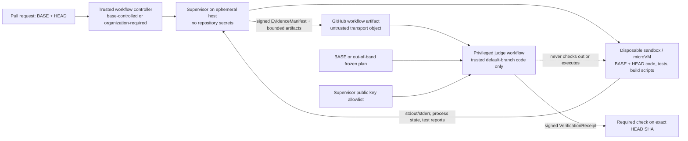
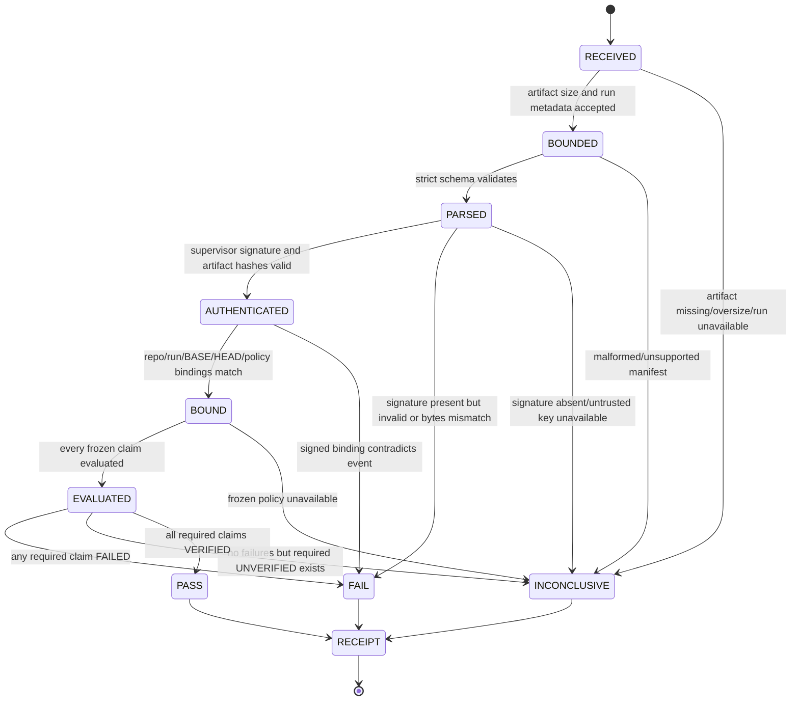

# PatchBound Verification Engine: HLD and LLD

**Status:** Proposed target architecture; this is a redesign specification, not a description of the current implementation.  
**Version:** 0.1  
**Date:** 2026-11-01

## 1. Executive design decision

PatchBound should be a deterministic patch-evidence engine. It accepts a base/head commit pair and a verification policy frozen from the base commit or an out-of-band source. Untrusted source, tests, build steps, and dependencies execute only inside an isolated sandbox. A trusted supervisor outside that sandbox records what actually ran and signs an evidence manifest. A separate deterministic judge checks the signed evidence against the frozen policy and emits a signed receipt.

The judge does not run repository code, does not use an LLM, and does not infer success from missing data. Its tri-state claim results are `VERIFIED`, `FAILED`, or `UNVERIFIED`; the overall verdict is `PASS`, `FAIL`, or `INCONCLUSIVE`.

New tests are evidence only when the same test source is transplanted onto BASE and produces a test-body assertion failure there, then passes on HEAD. Import, syntax, collection, fixture, timeout, and process failures on BASE do not count as fail-to-pass evidence.

This target design is substantially different from the current repository. Today `LocalTrustedSandbox` is a local `subprocess.run` wrapper, `VerificationRunner` drops the process exit code before parsing, `patch_verify_node` tests the supplied reproduction command and labels several verification flags true, and the V3 evaluator does not establish full-suite coverage. The current `.github/workflows` directory has basic test/package and publish workflows; it has no unprivileged executor/privileged judge split. The previous source audit reproduced a false V3 result. The specification below therefore defines required replacement behavior, not capabilities that can be claimed now.

## 2. Scope, assumptions, and non-goals

### In scope

- Compare a repository BASE commit with an immutable HEAD commit.
- Run a base-frozen command plan against isolated BASE and HEAD workspaces.
- Detect test deletions and modifications, test-oracle/config changes, and CI policy changes.
- Transplant newly introduced tests onto BASE and HEAD, with explicit outcome classification.
- Produce machine-verifiable evidence and a deterministic receipt.
- Integrate with GitHub Actions using unprivileged code execution and a privileged, non-executing judge.
- Support a Python/pytest adapter first; other test frameworks require explicit adapters.

### Assumptions

- BASE is the target repository’s trusted base revision for this evaluation. For public repositories, repository owners still need to control required workflow configuration and policy provenance.
- The candidate may contain malicious code. The threat model includes hostile tests, build scripts, test configuration, dependencies, artifact content, and GitHub event strings.
- A sandbox escape or compromised trusted supervisor is outside what a pure judge can repair. The sandbox host and supervisor signing path are part of the trusted computing base (TCB) and must be independently reviewed.
- A passing test suite is evidence about the tested behavior, not a mathematical proof that arbitrary code is correct or non-malicious.

### Non-goals

- Decide whether a natural-language issue has been solved.
- Let an LLM participate in policy selection or final verdict.
- Treat a passing target test as a full CI pass.
- Guarantee the semantic intent or quality of a newly added test from its differential result alone.
- Automatically merge, approve, or publish a patch.
- Build persistent job orchestration, vector search, agent memory, or a claim database.

## 3. Terminology

| Term | Meaning |
|---|---|
| **BASE** | Trusted commit chosen as the PR target baseline. It is identified by object ID, not a branch name. |
| **HEAD** | Candidate commit being evaluated. It is treated as untrusted data/code. |
| **Verification plan** | Commands, protected paths, resource limits, claims, and test-adapter version loaded from BASE or out-of-band policy. |
| **Sandbox** | Disposable isolated environment that executes BASE/HEAD code and tests without secrets or unrestricted host access. |
| **Supervisor** | Trusted process outside the sandbox. It starts commands, enforces limits, captures kernel/process results, hashes artifacts, and signs the manifest. |
| **Evidence manifest** | Signed observations produced by the supervisor. It contains no verdict. |
| **Claim definition** | Frozen deterministic predicate describing what evidence is required for one verification assertion. |
| **Judge** | Pure deterministic function that maps a validated plan, manifest, trust configuration, and GitHub binding to claim evaluations and a verdict. |
| **Receipt** | Judge-signed record binding the verdict to repository, BASE, HEAD, policy, manifest, and judge version. |
| **Test transplant** | Execution of HEAD-added test source against BASE code and against HEAD code using the same frozen test harness. |

## 4. Core invariants

1. **No untrusted code in the judge.** The privileged judge does not check out, import, build, source, or execute HEAD code. It parses bounded data and verifies signatures only.
2. **Supervisor outside the sandbox.** The supervisor observes command launch and termination independently. The sandbox cannot write the supervisor’s signing key, mutable run metadata, or receipt.
3. **No evidence means no pass.** Missing, malformed, unsupported, stale, unsigned, or ambiguous evidence yields `UNVERIFIED` and normally `INCONCLUSIVE`.
4. **Policy is frozen before execution.** The verification plan and claim set come only from BASE or an out-of-band trusted source. HEAD cannot change commands, test selection rules, policy, or the judge.
5. **Exit status is authoritative evidence.** A zero parsed test-failure count cannot override a nonzero exit code, timeout, signal, missing test run, collection failure, or malformed report.
6. **No implicit scope expansion.** A targeted command is reported as targeted. `FULL_SUITE_CLEAN` requires an explicitly named full-suite command to run to completion with a successful process result and adequate test execution evidence.
7. **Fail-to-pass is differential.** Each new test required by policy must fail on BASE in its test body with a recognized assertion failure and pass on HEAD. A BASE import/syntax/collection/setup failure is not F2P.
8. **Test tampering is visible.** Deleted or modified existing tests, changed test configuration, and altered CI/policy files are reported as policy violations or unverified conditions; they are never silently restored and then described as untouched.
9. **No unkeyed “signature.”** Hashes identify bytes. A signature is only claimed when a trusted key authenticates a payload and the verifier checks it against an out-of-band trust root.
10. **An immutable run has one answer.** A run is identified by repo ID, BASE, HEAD, workflow run ID/attempt, policy digest, and nonce. New execution evidence produces a new run/receipt; it does not rewrite an existing receipt.

## 5. High-Level Design

### 5.1 Component topology



### 5.2 Trust boundaries

| Boundary | Untrusted side | Trusted side | Required control |
|---|---|---|---|
| Repository code | HEAD source, tests, configs, build scripts, vendored tools | Supervisor host and judge | Execute only inside disposable sandbox; no secrets or host mounts. |
| Process observation | Test output and in-process JUnit/plugin reports | Supervisor-observed exit code, signal, timeout, wall/CPU/memory/disk accounting | Supervisor captures outside the guest; report parsers are bounded and strict. |
| Policy | HEAD’s changed workflow/config | BASE or out-of-band plan | Bind policy digest to exact BASE/policy revision; never load policy from HEAD. |
| Artifact transfer | Uploaded ZIP/JSON/logs | Judge verifier and trust store | Treat every artifact as attacker-controlled; size/path/schema/signature/binding checks before use. |
| GitHub authority | Pull request metadata and producer workflow | Privileged judge workflow | No write token/secrets in execution job; exact run/commit binding; minimal judge permissions. |
| Verdict | LLM output, test stdout, untrusted manifest status | Pure deterministic judge | LLM cannot produce claim status or final verdict. |

The supervisor is outside the sandbox but still belongs to the TCB. If repository code can escape the VM/container, alter host-side supervisor state, access signing material, or invoke the signer directly, the manifest is not trustworthy. Public-fork execution therefore requires a real isolation and attestation design; a `cwd` change, environment scrub, or ordinary subprocess wrapper is insufficient.

### 5.3 GitHub Actions split-job model

#### Job A — Unprivileged executor

- Trigger from a PR-safe event such as `pull_request`; do not use `pull_request_target` to run candidate code.
- Use an organization-required workflow or immutable reusable workflow/action for the trusted launcher. A workflow file editable by the PR cannot itself be the security root.
- Set job permissions explicitly to the minimum required, normally `contents: read` and no `id-token`, no write permissions, no repository/organization secrets, and no private package credentials.
- Use an ephemeral GitHub-hosted runner or a per-run self-hosted VM that is destroyed after use. Do not reuse a runner that can retain files, credentials, processes, caches, or network access between jobs.
- Run candidate code in a separate disposable VM/microVM or equivalently hardened environment. The supervisor is outside that guest and controls the command lifecycle. No Docker socket, host home, SSH agent, cloud metadata, or writable host checkout is mounted into the guest.
- Pin third-party Actions by full commit SHA and pin the supervisor image/toolchain by digest. Avoid untrusted caches shared with privileged jobs.
- The execution job must not possess a signing key or token that can mint evidence attestations. The trusted supervisor service/runner manager signs after independently observing the guest execution.
- Upload a bounded manifest and log/report artifacts. The artifact is still untrusted until the judge verifies its signature and bindings.

#### Job B — Privileged judge

- Trigger from a trusted `workflow_run` workflow defined on the default branch or from an external required workflow/App. GitHub documents that `workflow_run` is privileged and warns to treat artifacts from the preceding workflow as untrusted. The judge must not check out or execute the PR commit.
- Grant only the permissions needed to read the originating run/artifact and publish the required check, for example `actions: read` plus `checks: write`. Do not grant `contents: write`, `pull-requests: write`, or `id-token: write` without a concrete separate requirement.
- Select the exact originating workflow run and attempt. Verify repo numeric ID, event, workflow identity/SHA, run ID/attempt, artifact ID, PR number, BASE SHA, HEAD SHA, and freshness against trusted GitHub API metadata and the signed manifest.
- Download only the expected artifact by run ID and artifact ID. GitHub’s artifact digest can detect transport-byte mismatch, but it does not prove the uploaded report is truthful. The supervisor signature is the execution attestation.
- Treat archive names, paths, file sizes, compression ratios, JSON, XML, and text as hostile. Enforce total and per-file limits. Do not extract arbitrary paths. Do not deserialize pickle or import artifacts. Parse only the fixed schema and expected file names.
- Validate supervisor signature, manifest digest, artifact digests, policy digest, and binding before evaluating claims. If a trusted attestation is missing, return `INCONCLUSIVE`; never promote unsigned producer claims to PASS.
- Run only the pure judge implementation from trusted code. Sign the receipt and publish a check against the exact HEAD SHA. A retry, changed BASE, changed HEAD, changed policy, or new workflow attempt is a new run.

GitHub explicitly warns that `pull_request_target` workflows can have privileged tokens/secrets and must not execute untrusted pull request code. It also recommends least-privilege token permissions. `workflow_run` is appropriate for a privilege boundary only when its artifacts are treated as untrusted and not executed. GitHub’s artifact SHA-256 detects transfer mismatch; it is not an attestation of execution truth. See [Secure use reference](https://docs.github.com/en/actions/reference/security/secure-use), [securely using `pull_request_target`](https://docs.github.com/en/actions/reference/security/securely-using-pull_request_target), [workflow syntax and permissions](https://docs.github.com/en/actions/reference/workflows-and-actions/workflow-syntax), and [artifact validation](https://docs.github.com/en/actions/tutorials/store-and-share-data).

**Important limitation:** A plain two-job GitHub Actions YAML file does not automatically create a trustworthy supervisor. If the first job can be modified by the PR or can access signing credentials, it can forge evidence. The implementation must establish a trusted launcher and supervisor signing boundary using repository/organization workflow controls and an attestation mechanism inaccessible to sandboxed code. If that trust cannot be established, the judge must return `INCONCLUSIVE` or independently re-run checks through a trusted isolated service.

### 5.4 Component responsibilities

| Component | Responsibility | Must not do |
|---|---|---|
| Trusted workflow controller | Bind GitHub event to repo/base/head/run identity; select pinned launcher. | Execute candidate code or trust PR-supplied workflow policy. |
| Sandbox supervisor | Create VM, start/stop commands, apply limits, capture OS process results, hash artifacts, sign manifest. | Decide PASS/FAIL; use model output; expose keys to guest. |
| Sandbox guest | Run frozen test plan against BASE and HEAD plus test transplant. | Access secrets, modify trusted policy, produce a trusted signature. |
| Manifest validator | Enforce schema, size, identity, digest, signature, and replay checks. | Execute source, shell commands, or artifact-provided scripts. |
| Policy resolver | Load plan and claims from BASE or OOB source and compute digest. | Read settings from HEAD or workflow artifacts. |
| Deterministic judge | Evaluate each claim using fixed predicates and evidence. | Network, filesystem, clocks, LLMs, heuristics, implicit defaults. |
| Receipt publisher | Sign receipt and create a check on the exact SHA. | Merge, approve, or mutate source branch by default. |

## 6. Low-Level Design

### 6.1 Canonical data rules

- JSON is UTF-8, no duplicate keys, no NaN/Infinity, no unknown fields, and no arbitrary `dict[str, object]` extension bags.
- Pydantic v2 models below are normative. `model_json_schema()` generates the JSON Schema `$defs`; do not hand-maintain a separate schema that can drift.
- All digests are prefixed `sha256:`. Git object IDs accept 40 or 64 hex digits because repositories may use SHA-1 or SHA-256 object formats.
- Timestamps must be timezone-aware UTC. Duration/resource counters are integers, never floating-point values.
- Canonical signature bytes use RFC 8785 JSON Canonicalization Scheme (JCS), UTF-8. Manifest signature input is domain-separated and includes `manifest_digest`, `run_id`, repo ID, workflow run ID/attempt, BASE SHA, HEAD SHA, and policy digest.
- The `EvidenceManifest` signature is made by a trusted supervisor identity whose private key is unavailable to the sandbox. The judge receipt is separately signed by the judge identity.
- A digest proves byte identity only. Authenticity requires a valid signature rooted in trusted key configuration.

### 6.2 Pydantic models

The following is the normative schema module. In production, split it into `schemas/common.py`, `schemas/evidence.py`, `schemas/claims.py`, and `schemas/receipt.py` without changing the wire contract.

```python
from __future__ import annotations

import base64
import re
from datetime import datetime, timezone
from enum import StrEnum
from typing import Annotated, Literal
from uuid import UUID

from pydantic import (
    BaseModel,
    ConfigDict,
    Field,
    StrictBool,
    StrictInt,
    StrictStr,
    field_validator,
    model_validator,
)


Sha256 = Annotated[StrictStr, Field(pattern=r"^sha256:[0-9a-f]{64}$")]
GitOid = Annotated[StrictStr, Field(pattern=r"^(?:[0-9a-f]{40}|[0-9a-f]{64})$")]
NonNegativeInt = Annotated[StrictInt, Field(ge=0)]
PositiveInt = Annotated[StrictInt, Field(gt=0)]


def _safe_relative_path(value: str, *, allow_dot: bool = False) -> str:
    if allow_dot and value == ".":
        return value
    if (
        value.startswith(("/", "\\"))
        or "\\" in value
        or "\x00" in value
        or any(part in {"", ".", ".."} for part in value.split("/"))
    ):
        raise ValueError("path must be normalized and relative")
    return value


class StrictModel(BaseModel):
    model_config = ConfigDict(
        extra="forbid",
        frozen=True,
        strict=True,
        str_strip_whitespace=False,
        validate_default=True,
    )


class ExecutionPurpose(StrEnum):
    BASELINE_SUITE = "baseline_suite"
    HEAD_SUITE = "head_suite"
    TRANSPLANT_BASE = "transplant_base"
    TRANSPLANT_HEAD = "transplant_head"


class TerminationKind(StrEnum):
    EXITED = "exited"
    TIMEOUT = "timeout"
    SIGNAL = "signal"
    LAUNCH_ERROR = "launch_error"
    RESOURCE_LIMIT = "resource_limit"
    SUPERVISOR_ERROR = "supervisor_error"


class TestOutcome(StrEnum):
    PASSED = "passed"
    FAILED = "failed"
    SKIPPED = "skipped"
    XFAILED = "xfailed"
    ERROR = "error"
    NOT_COLLECTED = "not_collected"


class FailureClass(StrEnum):
    ASSERTION = "assertion"
    IMPORT = "import"
    SYNTAX = "syntax"
    COLLECTION = "collection"
    FIXTURE_SETUP = "fixture_setup"
    TEARDOWN = "teardown"
    TIMEOUT = "timeout"
    CRASH = "crash"
    SKIP = "skip"
    XFAIL = "xfail"
    UNKNOWN = "unknown"


class ArtifactKind(StrEnum):
    STDOUT = "stdout"
    STDERR = "stderr"
    JUNIT_XML = "junit_xml"
    TEST_INVENTORY = "test_inventory"
    DIFF = "diff"
    SUPERVISOR_LOG = "supervisor_log"


class EvidenceKind(StrEnum):
    MANIFEST_SIGNATURE = "manifest_signature"
    RUN_BINDING = "run_binding"
    POLICY_BINDING = "policy_binding"
    DIFF_INVENTORY = "diff_inventory"
    TEST_INVENTORY = "test_inventory"
    EXECUTION_RECORD = "execution_record"
    TEST_RESULT = "test_result"
    RESOURCE_USAGE = "resource_usage"


class PolicySource(StrEnum):
    BASE_COMMIT = "base_commit"
    OUT_OF_BAND = "out_of_band"


class SignatureAlgorithm(StrEnum):
    ED25519 = "ed25519"


class Verdict(StrEnum):
    PASS = "pass"
    FAIL = "fail"
    INCONCLUSIVE = "inconclusive"


class ClaimStatus(StrEnum):
    VERIFIED = "verified"
    FAILED = "failed"
    UNVERIFIED = "unverified"


class ClaimPredicate(StrEnum):
    MANIFEST_SIGNATURE_VALID = "manifest_signature_valid"
    RUN_BINDING_MATCHES = "run_binding_matches"
    POLICY_MATCHES_FROZEN_PLAN = "policy_matches_frozen_plan"
    NO_PROTECTED_CONTROL_CHANGES = "no_protected_control_changes"
    NO_EXISTING_TEST_DELETION_OR_MODIFICATION = "no_existing_test_deletion_or_modification"
    NEW_TESTS_ASSERTION_FAIL_ON_BASE = "new_tests_assertion_fail_on_base"
    NEW_TESTS_PASS_ON_HEAD = "new_tests_pass_on_head"
    NO_NEW_REGRESSIONS = "no_new_regressions"
    FULL_SUITE_CLEAN = "full_suite_clean"
    RESOURCE_LIMITS_RESPECTED = "resource_limits_respected"
    BASELINE_STABLE = "baseline_stable"


class ClaimScope(StrEnum):
    RUN = "run"
    POLICY = "policy"
    TEST_DELTA = "test_delta"
    NEW_TESTS = "new_tests"
    FULL_SUITE = "full_suite"
    EXECUTION = "execution"


class ReasonCode(StrEnum):
    SIGNATURE_MISSING = "signature_missing"
    SIGNATURE_INVALID = "signature_invalid"
    ARTIFACT_DIGEST_MISMATCH = "artifact_digest_mismatch"
    BINDING_MISMATCH = "binding_mismatch"
    POLICY_DIGEST_MISMATCH = "policy_digest_mismatch"
    EVIDENCE_MISSING = "evidence_missing"
    EVIDENCE_MALFORMED = "evidence_malformed"
    TEST_DELETED = "test_deleted"
    TEST_MODIFIED = "test_modified"
    TEST_ASSERTION_FAILED_ON_BASE = "test_assertion_failed_on_base"
    TEST_BASE_UNTRANSPLANTABLE = "test_base_untransplantable"
    TEST_FAILED_ON_HEAD = "test_failed_on_head"
    TEST_SKIPPED = "test_skipped"
    NEW_REGRESSION = "new_regression"
    BASELINE_FAILURE = "baseline_failure"
    FLAKY_BASELINE = "flaky_baseline"
    COMMAND_NONZERO = "command_nonzero"
    COMMAND_TIMEOUT = "command_timeout"
    RESOURCE_LIMIT_EXCEEDED = "resource_limit_exceeded"
    TEST_INVENTORY_INCOMPLETE = "test_inventory_incomplete"
    UNSUPPORTED_ADAPTER = "unsupported_adapter"
    CONFLICTING_EVIDENCE = "conflicting_evidence"
    POLICY_VIOLATION = "policy_violation"


class RepoBinding(StrictModel):
    host: Literal["github.com"]
    repository_id: PositiveInt
    owner: Annotated[StrictStr, Field(min_length=1, max_length=100)]
    name: Annotated[StrictStr, Field(min_length=1, max_length=100)]
    pull_request_number: PositiveInt
    workflow_run_id: PositiveInt
    workflow_attempt: PositiveInt
    workflow_sha: GitOid
    base_sha: GitOid
    head_sha: GitOid
    merge_base_sha: GitOid


class PolicyBinding(StrictModel):
    source: PolicySource
    policy_id: Annotated[StrictStr, Field(min_length=1, max_length=128)]
    policy_version: Annotated[StrictStr, Field(min_length=1, max_length=64)]
    source_revision: GitOid | None
    policy_digest: Sha256
    plan_digest: Sha256
    claim_set_digest: Sha256
    toolchain_digest: Sha256


class SupervisorIdentity(StrictModel):
    supervisor_id: Annotated[StrictStr, Field(min_length=1, max_length=128)]
    supervisor_version: Annotated[StrictStr, Field(min_length=1, max_length=64)]
    supervisor_image_digest: Sha256
    sandbox_profile: Annotated[StrictStr, Field(min_length=1, max_length=64)]
    sandbox_image_digest: Sha256
    attestation_key_id: Annotated[StrictStr, Field(min_length=1, max_length=128)]


class ResourceLimits(StrictModel):
    wall_time_seconds: PositiveInt
    cpu_time_seconds: PositiveInt
    memory_bytes: PositiveInt
    disk_bytes: PositiveInt
    process_count: PositiveInt
    output_bytes: PositiveInt
    network_mode: Literal["deny", "trusted_dependency_mirror_only"]


class ResourceUsage(StrictModel):
    cpu_ms: NonNegativeInt | None
    max_rss_bytes: NonNegativeInt | None
    disk_bytes: NonNegativeInt | None
    output_bytes: NonNegativeInt | None
    process_peak: NonNegativeInt | None


class ArtifactRef(StrictModel):
    artifact_id: Annotated[StrictStr, Field(min_length=1, max_length=128)]
    kind: ArtifactKind
    file_name: Annotated[StrictStr, Field(min_length=1, max_length=128)]
    media_type: Annotated[StrictStr, Field(min_length=1, max_length=128)]
    sha256: Sha256
    byte_length: NonNegativeInt

    @field_validator("file_name")
    @classmethod
    def safe_flat_file_name(cls, value: str) -> str:
        if (
            value in {".", ".."}
            or "/" in value
            or "\\" in value
            or "\x00" in value
            or not re.fullmatch(r"[A-Za-z0-9_.-]{1,128}", value)
        ):
            raise ValueError("artifact file_name must be a safe flat name")
        return value


class TestIdentity(StrictModel):
    node_id: Annotated[StrictStr, Field(min_length=1, max_length=512)]
    repo_path: Annotated[StrictStr, Field(min_length=1, max_length=512)]
    source_digest: Sha256

    @field_validator("repo_path")
    @classmethod
    def safe_repo_path(cls, value: str) -> str:
        return _safe_relative_path(value)


class DiffEntry(StrictModel):
    repo_path: Annotated[StrictStr, Field(min_length=1, max_length=512)]
    change: Literal["added", "modified", "deleted", "renamed", "type_changed"]
    base_blob: GitOid | None
    head_blob: GitOid | None
    classified_as: Literal["source", "test", "test_config", "ci_policy", "dependency", "other"]

    @field_validator("repo_path")
    @classmethod
    def safe_repo_path(cls, value: str) -> str:
        return _safe_relative_path(value)


class TestInventoryDelta(StrictModel):
    adapter_id: Annotated[StrictStr, Field(min_length=1, max_length=128)]
    adapter_version: Annotated[StrictStr, Field(min_length=1, max_length=64)]
    base_inventory_digest: Sha256
    head_inventory_digest: Sha256
    complete: StrictBool
    added: tuple[TestIdentity, ...] = Field(max_length=100_000)
    modified_existing: tuple[TestIdentity, ...] = Field(max_length=100_000)
    deleted_existing_ids: tuple[Annotated[StrictStr, Field(min_length=1, max_length=512)], ...] = Field(max_length=100_000)
    collection_error_digest: Sha256 | None

    @model_validator(mode="after")
    def unique_ids(self) -> TestInventoryDelta:
        ids = [t.node_id for t in self.added]
        if len(ids) != len(set(ids)):
            raise ValueError("added test node IDs must be unique")
        modified_ids = [t.node_id for t in self.modified_existing]
        if len(modified_ids) != len(set(modified_ids)):
            raise ValueError("modified existing test IDs must be unique")
        if set(ids) & set(modified_ids):
            raise ValueError("test IDs cannot be both added and modified-existing")
        if len(self.deleted_existing_ids) != len(set(self.deleted_existing_ids)):
            raise ValueError("deleted existing test IDs must be unique")
        if set(ids) & set(self.deleted_existing_ids):
            raise ValueError("a test cannot be both added and deleted")
        return self


class TestOutcomeRecord(StrictModel):
    node_id: Annotated[StrictStr, Field(min_length=1, max_length=512)]
    outcome: TestOutcome
    phase: Literal["collection", "setup", "call", "teardown"] | None
    failure_class: FailureClass | None
    failure_fingerprint: Sha256 | None
    duration_ms: NonNegativeInt

    @model_validator(mode="after")
    def failure_has_class(self) -> TestOutcomeRecord:
        if self.outcome in {TestOutcome.FAILED, TestOutcome.ERROR} and self.failure_class is None:
            raise ValueError("failed/error tests require failure_class")
        if self.failure_class == FailureClass.ASSERTION and self.phase != "call":
            raise ValueError("assertion failures count only in the test call phase")
        if self.outcome == TestOutcome.SKIPPED and self.failure_class not in {None, FailureClass.SKIP}:
            raise ValueError("skipped tests can only use the SKIP failure class")
        if self.outcome == TestOutcome.XFAILED and self.failure_class not in {None, FailureClass.XFAIL}:
            raise ValueError("xfailed tests can only use the XFAIL failure class")
        return self


class ExecutionRecord(StrictModel):
    execution_id: UUID
    purpose: ExecutionPurpose
    commit_sha: GitOid
    tree_oid: GitOid
    command_id: Annotated[StrictStr, Field(min_length=1, max_length=128)]
    command_argv: tuple[Annotated[StrictStr, Field(max_length=2048)], ...] = Field(min_length=1, max_length=128)
    command_digest: Sha256
    command_source: Literal["base_commit", "out_of_band"]
    started_at: datetime
    duration_ms: NonNegativeInt
    termination: TerminationKind
    exit_code: StrictInt | None
    signal_number: PositiveInt | None
    resource_usage: ResourceUsage
    stdout: ArtifactRef | None
    stderr: ArtifactRef | None
    junit: ArtifactRef | None
    test_results: tuple[TestOutcomeRecord, ...] = Field(max_length=100_000)

    @field_validator("started_at")
    @classmethod
    def utc_timestamp(cls, value: datetime) -> datetime:
        if value.tzinfo is None or value.utcoffset() is None:
            raise ValueError("started_at must be timezone-aware")
        return value.astimezone(timezone.utc)

    @model_validator(mode="after")
    def consistent_termination(self) -> ExecutionRecord:
        if self.termination == TerminationKind.EXITED:
            if self.exit_code is None or self.signal_number is not None:
                raise ValueError("EXITED requires exit_code and forbids signal_number")
        elif self.termination == TerminationKind.SIGNAL:
            if self.signal_number is None or self.exit_code is not None:
                raise ValueError("SIGNAL requires signal_number and forbids exit_code")
        elif self.exit_code is not None:
            raise ValueError("abnormal termination cannot report an exit code")
        ids = [result.node_id for result in self.test_results]
        if len(ids) != len(set(ids)):
            raise ValueError("test_results must have unique node IDs per execution")
        return self


class TestTransplantRecord(StrictModel):
    node_id: Annotated[StrictStr, Field(min_length=1, max_length=512)]
    test_source_digest: Sha256
    base_execution_id: UUID
    head_execution_id: UUID


class SignatureEnvelope(StrictModel):
    algorithm: SignatureAlgorithm
    key_id: Annotated[StrictStr, Field(min_length=1, max_length=128)]
    purpose: Literal["evidence_manifest", "verification_receipt"]
    payload_digest: Sha256
    signature_base64: Annotated[StrictStr, Field(min_length=1, max_length=256)]
    signed_at: datetime

    @field_validator("signature_base64")
    @classmethod
    def valid_base64(cls, value: str) -> str:
        try:
            decoded = base64.b64decode(value, validate=True)
        except Exception as exc:
            raise ValueError("signature_base64 must be valid base64") from exc
        if len(decoded) != 64:
            raise ValueError("Ed25519 signature must decode to 64 bytes")
        return value

    @field_validator("signed_at")
    @classmethod
    def utc_timestamp(cls, value: datetime) -> datetime:
        if value.tzinfo is None or value.utcoffset() is None:
            raise ValueError("signed_at must be timezone-aware")
        return value.astimezone(timezone.utc)


class EvidenceManifest(StrictModel):
    schema_version: Literal["1.0"]
    run_id: UUID
    created_at: datetime
    repository: RepoBinding
    policy: PolicyBinding
    supervisor: SupervisorIdentity
    limits: ResourceLimits
    diff_entries: tuple[DiffEntry, ...] = Field(max_length=100_000)
    test_delta: TestInventoryDelta
    executions: tuple[ExecutionRecord, ...] = Field(max_length=10_000)
    transplants: tuple[TestTransplantRecord, ...] = Field(max_length=100_000)
    artifacts: tuple[ArtifactRef, ...] = Field(max_length=10_000)
    attestation: SignatureEnvelope

    @field_validator("created_at")
    @classmethod
    def utc_timestamp(cls, value: datetime) -> datetime:
        if value.tzinfo is None or value.utcoffset() is None:
            raise ValueError("created_at must be timezone-aware")
        return value.astimezone(timezone.utc)

    @model_validator(mode="after")
    def unique_and_referentially_valid(self) -> EvidenceManifest:
        execution_ids = [execution.execution_id for execution in self.executions]
        if len(execution_ids) != len(set(execution_ids)):
            raise ValueError("execution IDs must be unique")
        artifact_ids = [artifact.artifact_id for artifact in self.artifacts]
        if len(artifact_ids) != len(set(artifact_ids)):
            raise ValueError("artifact IDs must be unique")
        execution_by_id = {execution.execution_id: execution for execution in self.executions}
        artifact_by_id = {artifact.artifact_id: artifact for artifact in self.artifacts}
        added_tests = {test.node_id: test for test in self.test_delta.added}
        transplant_ids = [transplant.node_id for transplant in self.transplants]
        if len(transplant_ids) != len(set(transplant_ids)):
            raise ValueError("transplant test IDs must be unique")
        for execution in self.executions:
            expected_sha = (
                self.repository.base_sha
                if execution.purpose in {ExecutionPurpose.BASELINE_SUITE, ExecutionPurpose.TRANSPLANT_BASE}
                else self.repository.head_sha
            )
            if execution.commit_sha != expected_sha:
                raise ValueError("execution commit does not match its purpose and run binding")
            for artifact in (execution.stdout, execution.stderr, execution.junit):
                if artifact is not None and artifact_by_id.get(artifact.artifact_id) != artifact:
                    raise ValueError("execution references an absent or mismatched artifact")
        for transplant in self.transplants:
            base_execution = execution_by_id.get(transplant.base_execution_id)
            if base_execution is None:
                raise ValueError("transplant references missing BASE execution")
            head_execution = execution_by_id.get(transplant.head_execution_id)
            if head_execution is None:
                raise ValueError("transplant references missing HEAD execution")
            if base_execution.purpose != ExecutionPurpose.TRANSPLANT_BASE:
                raise ValueError("transplant BASE reference has wrong execution purpose")
            if head_execution.purpose != ExecutionPurpose.TRANSPLANT_HEAD:
                raise ValueError("transplant HEAD reference has wrong execution purpose")
            if transplant.node_id not in {result.node_id for result in base_execution.test_results}:
                raise ValueError("transplant BASE execution lacks the referenced test result")
            if transplant.node_id not in {result.node_id for result in head_execution.test_results}:
                raise ValueError("transplant HEAD execution lacks the referenced test result")
            added_test = added_tests.get(transplant.node_id)
            if added_test is None or added_test.source_digest != transplant.test_source_digest:
                raise ValueError("transplant must reference the exact source digest of an added test")
        if self.attestation.purpose != "evidence_manifest":
            raise ValueError("manifest attestation has wrong purpose")
        if self.attestation.key_id != self.supervisor.attestation_key_id:
            raise ValueError("attestation key ID differs from supervisor identity")
        if self.policy.source == PolicySource.BASE_COMMIT and self.policy.source_revision != self.repository.base_sha:
            raise ValueError("BASE-sourced policy revision must equal bound BASE SHA")
        return self


class NetworkMode(StrEnum):
    DENY = "deny"
    TRUSTED_DEPENDENCY_MIRROR_ONLY = "trusted_dependency_mirror_only"


class CommandDefinition(StrictModel):
    command_id: Annotated[StrictStr, Field(min_length=1, max_length=128)]
    purpose: ExecutionPurpose
    argv: tuple[Annotated[StrictStr, Field(max_length=2048)], ...] = Field(min_length=1, max_length=128)
    working_directory: Annotated[StrictStr, Field(min_length=1, max_length=256)]
    timeout_seconds: PositiveInt
    repetitions: PositiveInt = 1
    network_mode: NetworkMode = NetworkMode.DENY

    @field_validator("working_directory")
    @classmethod
    def safe_working_directory(cls, value: str) -> str:
        return _safe_relative_path(value, allow_dot=True)


class ClaimParameters(StrictModel):
    min_new_test_count: NonNegativeInt = 0
    allowed_baseline_failure_fingerprints: tuple[Sha256, ...] = Field(default=(), max_length=10_000)
    require_exact_test_inventory: StrictBool = True


class ClaimDefinition(StrictModel):
    claim_id: Annotated[StrictStr, Field(pattern=r"^[a-z][a-z0-9_.-]{1,127}$")]
    version: PositiveInt
    predicate: ClaimPredicate
    scope: ClaimScope
    required: StrictBool = True
    required_evidence_kinds: tuple[EvidenceKind, ...] = Field(min_length=1, max_length=16)
    parameters: ClaimParameters = Field(default_factory=ClaimParameters)

    @model_validator(mode="after")
    def validate_predicate_scope(self) -> ClaimDefinition:
        allowed_scope = {
            ClaimPredicate.MANIFEST_SIGNATURE_VALID: ClaimScope.RUN,
            ClaimPredicate.RUN_BINDING_MATCHES: ClaimScope.RUN,
            ClaimPredicate.POLICY_MATCHES_FROZEN_PLAN: ClaimScope.POLICY,
            ClaimPredicate.NO_PROTECTED_CONTROL_CHANGES: ClaimScope.POLICY,
            ClaimPredicate.NO_EXISTING_TEST_DELETION_OR_MODIFICATION: ClaimScope.TEST_DELTA,
            ClaimPredicate.NEW_TESTS_ASSERTION_FAIL_ON_BASE: ClaimScope.NEW_TESTS,
            ClaimPredicate.NEW_TESTS_PASS_ON_HEAD: ClaimScope.NEW_TESTS,
            ClaimPredicate.NO_NEW_REGRESSIONS: ClaimScope.FULL_SUITE,
            ClaimPredicate.FULL_SUITE_CLEAN: ClaimScope.FULL_SUITE,
            ClaimPredicate.RESOURCE_LIMITS_RESPECTED: ClaimScope.EXECUTION,
            ClaimPredicate.BASELINE_STABLE: ClaimScope.FULL_SUITE,
        }[self.predicate]
        if self.scope != allowed_scope:
            raise ValueError(f"{self.predicate.value} requires scope={allowed_scope.value}")
        if len(self.required_evidence_kinds) != len(set(self.required_evidence_kinds)):
            raise ValueError("required_evidence_kinds must be unique")
        return self


class FrozenVerificationPlan(StrictModel):
    schema_version: Literal["1.0"]
    policy_id: Annotated[StrictStr, Field(min_length=1, max_length=128)]
    policy_version: Annotated[StrictStr, Field(min_length=1, max_length=64)]
    source: PolicySource
    source_revision: GitOid | None
    commands: tuple[CommandDefinition, ...] = Field(min_length=1, max_length=64)
    claims: tuple[ClaimDefinition, ...] = Field(min_length=1, max_length=128)
    protected_paths: tuple[Annotated[StrictStr, Field(min_length=1, max_length=512)], ...] = Field(max_length=10_000)
    limits: ResourceLimits
    test_adapter_id: Annotated[StrictStr, Field(min_length=1, max_length=128)]
    test_adapter_version: Annotated[StrictStr, Field(min_length=1, max_length=64)]

    @model_validator(mode="after")
    def unique_names_and_required_claims(self) -> FrozenVerificationPlan:
        command_ids = [command.command_id for command in self.commands]
        claim_ids = [claim.claim_id for claim in self.claims]
        if len(command_ids) != len(set(command_ids)):
            raise ValueError("command IDs must be unique")
        if len(claim_ids) != len(set(claim_ids)):
            raise ValueError("claim IDs must be unique")
        if not any(claim.required for claim in self.claims):
            raise ValueError("at least one claim must be required")
        if self.source == PolicySource.BASE_COMMIT and self.source_revision is None:
            raise ValueError("BASE policy requires source_revision")
        return self


class ClaimEvaluation(StrictModel):
    claim_id: Annotated[StrictStr, Field(min_length=1, max_length=128)]
    status: ClaimStatus
    reason_codes: tuple[ReasonCode, ...] = Field(max_length=32)
    evidence_refs: tuple[Annotated[StrictStr, Field(min_length=1, max_length=128)], ...] = Field(max_length=10_000)
    explanation: Annotated[StrictStr, Field(max_length=2048)]


class JudgeIdentity(StrictModel):
    judge_id: Annotated[StrictStr, Field(min_length=1, max_length=128)]
    judge_version: Annotated[StrictStr, Field(min_length=1, max_length=64)]
    judge_image_digest: Sha256
    signing_key_id: Annotated[StrictStr, Field(min_length=1, max_length=128)]


class VerificationReceipt(StrictModel):
    schema_version: Literal["1.0"]
    receipt_id: UUID
    run_id: UUID
    created_at: datetime
    repository: RepoBinding
    policy_digest: Sha256
    plan_digest: Sha256
    claim_set_digest: Sha256
    manifest_digest: Sha256
    judge: JudgeIdentity
    claim_definitions: tuple[ClaimDefinition, ...] = Field(min_length=1, max_length=128)
    evaluations: tuple[ClaimEvaluation, ...] = Field(min_length=1, max_length=128)
    verdict: Verdict
    receipt_digest: Sha256
    signature: SignatureEnvelope

    @field_validator("created_at")
    @classmethod
    def utc_timestamp(cls, value: datetime) -> datetime:
        if value.tzinfo is None or value.utcoffset() is None:
            raise ValueError("created_at must be timezone-aware")
        return value.astimezone(timezone.utc)

    @model_validator(mode="after")
    def verdict_matches_required_claims(self) -> VerificationReceipt:
        definitions = {definition.claim_id: definition for definition in self.claim_definitions}
        evaluations = {evaluation.claim_id: evaluation for evaluation in self.evaluations}
        if len(definitions) != len(self.claim_definitions):
            raise ValueError("claim definitions must be unique")
        if len(evaluations) != len(self.evaluations):
            raise ValueError("claim evaluations must be unique")
        if set(definitions) != set(evaluations):
            raise ValueError("receipt must evaluate every frozen claim exactly once")
        required = [evaluations[key].status for key, definition in definitions.items() if definition.required]
        expected = (
            Verdict.FAIL if ClaimStatus.FAILED in required
            else Verdict.INCONCLUSIVE if ClaimStatus.UNVERIFIED in required
            else Verdict.PASS
        )
        if self.verdict != expected:
            raise ValueError("verdict does not match required claim evaluations")
        if self.signature.purpose != "verification_receipt":
            raise ValueError("receipt signature has wrong purpose")
        if self.signature.key_id != self.judge.signing_key_id:
            raise ValueError("receipt signature key ID differs from judge identity")
        if self.signature.payload_digest != self.receipt_digest:
            raise ValueError("receipt signature must bind receipt_digest")
        return self
```

Generate schema artifacts from the normative models in CI:

```python
EvidenceManifest.model_json_schema(mode="serialization")
ClaimDefinition.model_json_schema(mode="serialization")
VerificationReceipt.model_json_schema(mode="serialization")
```

Commit generated schema JSON under `schemas/v1/` and test that regenerating it produces no diff. The judge must validate input with strict Pydantic parsing and reject unknown fields. A schema version change is required for incompatible changes.

### 6.3 Frozen plan and claim set

The `FrozenVerificationPlan` is loaded before untrusted execution:

1. Prefer an out-of-band plan owned by the repository administrator or organization.
2. Otherwise read a designated plan file from exact BASE SHA using Git object reads. Do not run its code, and do not read the corresponding HEAD file for policy.
3. Parse strict JSON or safe YAML into the strict schema. Unknown keys, duplicate command IDs, duplicate claim IDs, invalid command forms, or missing required claims cause `INCONCLUSIVE` or a policy configuration failure; they never receive defaults that weaken controls.
4. Hash the canonical plan and claim definitions. Bind both digests into the manifest and receipt.

Commands are argv arrays, not shell strings. The trusted runner may append exact test node IDs as argv entries. It must not evaluate shell interpolation or source scripts from HEAD to discover how to test the project. If the policy intentionally invokes a script committed at BASE, the command is frozen to that BASE path and any corresponding HEAD modification is a protected-control change.

Example frozen claim set:

```json
[
  {"claim_id":"manifest.signature","version":1,"predicate":"manifest_signature_valid","scope":"run","required":true,"required_evidence_kinds":["manifest_signature"],"parameters":{}},
  {"claim_id":"run.binding","version":1,"predicate":"run_binding_matches","scope":"run","required":true,"required_evidence_kinds":["run_binding"],"parameters":{}},
  {"claim_id":"policy.frozen","version":1,"predicate":"policy_matches_frozen_plan","scope":"policy","required":true,"required_evidence_kinds":["policy_binding"],"parameters":{}},
  {"claim_id":"ci.controls","version":1,"predicate":"no_protected_control_changes","scope":"policy","required":true,"required_evidence_kinds":["diff_inventory"],"parameters":{}},
  {"claim_id":"tests.unchanged","version":1,"predicate":"no_existing_test_deletion_or_modification","scope":"test_delta","required":true,"required_evidence_kinds":["test_inventory","diff_inventory"],"parameters":{"require_exact_test_inventory":true}},
  {"claim_id":"tests.new.f2p","version":1,"predicate":"new_tests_assertion_fail_on_base","scope":"new_tests","required":true,"required_evidence_kinds":["execution_record","test_result"],"parameters":{"min_new_test_count":0}},
  {"claim_id":"tests.new.head_pass","version":1,"predicate":"new_tests_pass_on_head","scope":"new_tests","required":true,"required_evidence_kinds":["execution_record","test_result"],"parameters":{"min_new_test_count":0}},
  {"claim_id":"suite.no_regression","version":1,"predicate":"no_new_regressions","scope":"full_suite","required":true,"required_evidence_kinds":["execution_record","test_inventory","test_result"],"parameters":{"require_exact_test_inventory":true}},
  {"claim_id":"resources.within_limits","version":1,"predicate":"resource_limits_respected","scope":"execution","required":true,"required_evidence_kinds":["resource_usage"],"parameters":{}}
]
```

`min_new_test_count=0` makes the F2P universal claim vacuously true if no new tests exist. A policy that requires tests for a certain change class must set `min_new_test_count` accordingly or add a separate required coverage claim. The receipt must always expose the actual added-test count; vacuous truth must not be presented as demonstrated test coverage.

### 6.4 EvidenceManifest semantics

The manifest records observations, not conclusions:

- Exact repo ID, PR number, workflow run/attempt, BASE, HEAD, merge base, and workflow SHA.
- Policy/plan/claim-set/toolchain digests and their trusted source.
- Supervisor and sandbox image/profile identities.
- Resource limits and observed resource usage for every execution.
- Full BASE-to-HEAD diff entry inventory, including deleted/modified tests and protected CI/policy/dependency paths.
- Base/head test inventory digests and explicit added, modified, and deleted test identities.
- One `ExecutionRecord` for each planned command execution, including argv, command digest, tree OID, start time, duration, termination cause, exit code/signal, test results, and artifact references.
- One transplant record for each new test the plan requires to be transplanted.
- Digests and sizes of bounded logs/JUnit reports. Raw stdout is not authority for exit status.
- A signature over canonical manifest payload and run binding.

The manifest must not include `verdict`, `claim_status`, or `human_approved`. Those are judge/receipt concepts. If a producer includes those fields, strict parsing rejects them.

### 6.5 ClaimDefinition semantics

`ClaimDefinition` is trusted policy input, not producer input. The manifest cannot introduce a new claim, weaken `required`, alter a predicate, or change thresholds. `required_evidence_kinds` names evidence classes only; the predicate implementation defines exact field-level checks. Predicates are a closed enum. Never evaluate arbitrary Python, SQL, JSONPath, regex code, or an LLM-generated expression as a claim.

Initial predicates should be pure functions:

| Predicate | `VERIFIED` condition | `FAILED` condition | Otherwise |
|---|---|---|---|
| `manifest_signature_valid` | Signature verifies under allowlisted key; canonical payload digest matches. | Signature present but invalid, digest differs, or key is revoked. | Signature or trust configuration missing. |
| `run_binding_matches` | Manifest repo/run/attempt/BASE/HEAD matches trusted workflow/API event. | Any signed binding contradicts event. | Trusted event metadata unavailable. |
| `policy_matches_frozen_plan` | Policy, plan, and claim-set digests match trusted BASE/OOB values. | Signed manifest declares a different digest. | Plan cannot be resolved or was malformed. |
| `no_protected_control_changes` | No prohibited CI/workflow/test-config/policy path changed. | Protected control was added/modified/deleted contrary to policy. | Diff inventory is incomplete. |
| `no_existing_test_deletion_or_modification` | Required base test inventory is complete and existing tests are unchanged. | Any existing test removed, weakened/modified, or test inventory shrank against policy. | Adapter cannot establish complete identity. |
| `new_tests_assertion_fail_on_base` | Every required new test was collected and its call phase failed with `ASSERTION`; minimum count met. | A new test passed on BASE or policy says required minimum is unmet. | Import/syntax/collection/setup/timeout/unsupported failure prevents meaningful assertion result. |
| `new_tests_pass_on_head` | Every required new test ran on HEAD and passed; none skipped/xfail/error. | A new test fails, errors, is skipped, xfailed, or was not executed on HEAD. | HEAD execution evidence missing or incomplete. |
| `no_new_regressions` | Frozen BASE and HEAD suite runs are complete and HEAD introduces no failure/skip/inventory regression outside explicitly approved baseline failures. | New failure, new skip, deleted test, or prohibited suite reduction appears on HEAD. | Baseline unstable, either run incomplete, or adapter output ambiguous. |
| `full_suite_clean` | The explicitly designated full-suite command ran on HEAD, exited zero, executed the expected inventory, and reported no failures/skips/errors. | Any failure, skip, missing test, or nonzero/abnormal process outcome. | Full-suite command or complete inventory evidence is missing. |
| `resource_limits_respected` | Supervisor-observed limits are within the frozen limits. | Wall/CPU/memory/disk/process/output limit exceeded. | Required resource metrics are unavailable. |
| `baseline_stable` | Required repeated BASE runs agree under the plan’s test/result fingerprint policy. | BASE produces inconsistent outcomes under a policy that treats that as a failure. | Baseline is flaky/unstable without a trusted classification policy. |

### 6.6 VerificationReceipt semantics

The receipt is generated only by the privileged judge. It contains the complete frozen claim definitions and exactly one evaluation per claim, so a downstream check consumer can understand the decision without reinterpreting the manifest. `receipt_digest` is SHA-256 over canonical receipt content excluding `receipt_digest` and `signature`; the judge signs that digest plus a domain separator.

Verdict function over **required** claims:

```text
if any required claim is FAILED:       verdict = FAIL
else if any required claim is UNVERIFIED: verdict = INCONCLUSIVE
else:                                  verdict = PASS
```

No majority vote, score, confidence average, retry heuristic, or “best attempt” can override this function. A receipt has a deterministic verdict for fixed validated inputs and judge version. `created_at` and receipt signature are envelope metadata and do not affect the pure verdict.

## 7. Deterministic judge state machine

### 7.1 Stages



### 7.2 Judge API

Separate impure acquisition from the evaluator:

```python
def acquire_judge_input(event, artifact_api, trusted_policy_store, trust_store) -> JudgeInput:
    """I/O only: fetch exact event/run/artifact and trusted plan/key material."""


def evaluate(input: JudgeInput) -> JudgeDecision:
    """Pure function: validated immutable inputs -> claim evaluations + verdict."""


def sign_receipt(decision: JudgeDecision, signer) -> VerificationReceipt:
    """Envelope operation performed by trusted judge after deterministic evaluation."""
```

`evaluate` must not call GitHub, read the filesystem, inspect the clock, load environment variables, invoke subprocesses, access a model, or mutate input. The wrapper may fetch a policy and signature public keys before evaluation, but then freezes them into `JudgeInput`.

### 7.3 Monotonicity and immutability rules

Monotonicity is defined over an immutable run identity and trusted policy digest. It does not mean that contradictory later evidence is ignored.

1. **Determinism:** Same canonical `JudgeInput` and judge version produce byte-equivalent claim evaluations and the same verdict.
2. **Missing evidence is not success:** Removing required evidence may move `VERIFIED` to `UNVERIFIED` and `PASS` to `INCONCLUSIVE`; it cannot preserve PASS by default.
3. **No failure erasure:** Adding unrelated evidence cannot turn a required `FAILED` claim into `VERIFIED`; a `FAIL` decision for an immutable evidence set cannot become PASS through evidence ordering or duplicate records.
4. **Conflict is conservative:** Duplicate records with conflicting outcomes cause the relevant claim to be `FAILED` when a trusted contradiction exists, otherwise `UNVERIFIED`; they never resolve by “last write wins.”
5. **Evidence is append-only per run:** A new artifact or execution attempt changes the manifest digest and creates a new run revision/receipt. The old receipt remains unchanged and addressable.
6. **No policy mutation:** Changing BASE, HEAD, plan, claim set, adapter, or supervisor version creates a new policy/run binding. The old result cannot be upgraded under the new inputs.
7. **No verdict aggregation across attempts:** A successful later run does not erase an earlier failed run. A PR check refers to the specific latest run/attempt under an explicit freshness rule; prior receipts remain available.

For added evidence, a prior `INCONCLUSIVE` may resolve to PASS or FAIL as missing facts become known. A prior PASS may become FAIL only through a new receipt that includes authoritative contradictory evidence; it is not a mutation of the old receipt. These rules avoid pretending that a mutable evidence bag has an absolute monotonic verdict.

## 8. Test transplant lifecycle

### 8.1 Inventory and classification

Use a trusted, versioned test adapter from the supervisor image. For the first adapter, use pytest and a fixed invocation. Do not load plugins/configuration automatically from HEAD.

1. Read BASE and HEAD Git trees by immutable object ID and compute a complete diff inventory.
2. Classify test source, test configuration, CI workflow, policy, dependency lock, and ordinary source using base-frozen path rules plus the adapter.
3. Inventory tests on BASE and HEAD in the sandbox using the pinned adapter. The collector is untrusted execution and must run under the same sandbox limits.
4. Define `new_tests = head_node_ids - base_node_ids` only when both inventories are complete and comparable.
5. Any existing test node ID with changed source, deleted test file/node ID, changed `conftest.py`, test runner config, or test discovery configuration is a protected test change. Default policy marks it `FAILED`; an explicitly approved out-of-band policy can define a narrower exception.
6. If the framework cannot provide stable test identities, mark inventory and transplant claims `UNVERIFIED`. Do not guess from filenames or stdout summaries.

For pytest, stable identity includes the complete node ID and parameter IDs, source path, and source digest. Dynamic collection affected by environment, plugins, current time, network, or HEAD-specific discovery is a failed comparability check or `UNVERIFIED`, never an empty test set treated as success.

### 8.2 Constructing the BASE transplant workspace

1. Create an immutable BASE worktree in the sandbox.
2. Apply only the new-test source bundle and explicitly allowed new test-support files from HEAD to a separate overlay. The application source remains BASE.
3. Use BASE’s frozen command, config, dependency environment, and trusted test adapter. Disable plugin autoload and use explicit base config paths.
4. Do not overlay HEAD `conftest.py`, pytest config, CI scripts, or dependency lock/config unless the policy explicitly permits that class. The initial policy should reject those changes.
5. If a new test imports a helper or dependency that cannot be transplanted without importing changed HEAD application/configuration code, mark it untransplantable. A BASE import error is not an assertion failure.
6. Run each newly introduced node ID in a fresh process (or a controlled isolated batch) with a supervisor-recorded command. No shell is used.

The transplant bundle is still untrusted code. It must never run outside the sandbox. The purpose of the overlay is to keep application code at BASE while using the candidate’s new test code.

### 8.3 BASE result classification

For each new test, the BASE result qualifies as fail-to-pass evidence only when:

- The exact node ID was collected and executed.
- The process completed under limits; no timeout, crash, signal, or runner error occurred.
- The test reached the call phase.
- The call phase failed with the adapter’s recognized assertion class (`AssertionError` for the initial pytest adapter).
- The test was not skipped, xfailed, deselected, or intercepted by collection/config behavior.
- The supervisor records exact source and execution digests.

Classification:

| BASE outcome | F2P interpretation |
|---|---|
| Call-phase assertion failure | `VERIFIED` for the claim “this new test detects a difference on BASE,” subject to HEAD result. |
| Import/module error | `UNVERIFIED`; test may simply require a dependency or symbol absent from BASE. |
| Syntax error | `UNVERIFIED`; not evidence that an assertion detects a bug. |
| Collection error / no node ID | `UNVERIFIED`. |
| Fixture setup/teardown error | `UNVERIFIED`. |
| Timeout, crash, signal, supervisor error | `UNVERIFIED`. |
| Pass on BASE | `FAILED` for the required F2P predicate. |
| Skip, xfail, deselected, or zero executed | `FAILED` if the evidence proves deliberate non-execution; otherwise `UNVERIFIED`. In neither case does it verify F2P. |

### 8.4 HEAD result classification

Run the same test source and node IDs against HEAD code with the same base-frozen test plan and comparable dependency image. Every required new test must execute and pass. A HEAD syntax/import/collection/setup error, assertion failure, skip, xfail, timeout, crash, or nonzero process result fails the “new tests pass on HEAD” claim. Missing/contradictory test evidence is unverified.

### 8.5 Limits of test transplant

Transplant proves a differential outcome under a specific runner/environment; it does not prove the test’s intent is legitimate. A malicious test can be written to distinguish BASE and HEAD for an irrelevant reason. The judge must not claim semantic correctness from F2P alone. Controls are:

- prohibit existing test modifications/deletions by default;
- freeze test config and command from BASE/OOB;
- require the same test node IDs and comparable environments on both sides;
- report each transplant outcome, source digest, and adapter version;
- run the full frozen regression plan and inspect the exact diff;
- keep human review as a separate governance action, not an input to the deterministic test verdict.

If hostile test authors can compromise the test runner’s in-process reporting, a pytest plugin alone is not an independent oracle. The supervisor must observe process exit/limits outside the process, and the sandbox/adapter must prevent tests from writing trusted supervisor files. The judge should treat test-level classification as evidence from the pinned adapter, not as proof immune to arbitrary test-code deception.

## 9. Core use cases and failure modes

### 9.1 Agent reward-hacking / test-oracle manipulation

**Scenario:** An agent changes implementation and also edits/deletes tests, adds skips/xfails, modifies `conftest.py`, changes pytest config, or alters CI commands so the patch appears green.

**Flow:**

1. The frozen BASE plan supplies command IDs, protected paths, test adapter, and required claims.
2. Supervisor records complete BASE→HEAD file/test inventories; it does not trust HEAD’s reported test list.
3. Deleted/modified existing tests or protected test/CI configuration set the corresponding claim to `FAILED` under default policy.
4. New node IDs are transplanted onto BASE. Only call-phase assertion failures satisfy the BASE side.
5. The exact new tests are run on HEAD and must pass without skips/errors.
6. The full frozen regression command compares BASE and HEAD failures; test-count reduction or new failures fails the regression claim.
7. Pure judge emits FAIL/INCONCLUSIVE/PASS with evidence refs. No LLM can mark its own patch verified.

**Limit:** This detects listed forms of test/CI tampering, not all semantically dishonest tests. An adversarial new test may fail on BASE and pass on HEAD while checking irrelevant behavior; that limitation is disclosed in the receipt/design.

### 9.2 Pre-existing failures

**Scenario:** BASE already has failing tests before the candidate patch.

**Flow:**

1. Run BASE suite the number of times required by frozen policy using clean workspaces and identical image/limits.
2. Build normalized failure fingerprints from test node ID, phase, exception class, and normalized failure digest. Do not normalize away meaningful assertion text.
3. If BASE is inconsistent across repetitions, mark `baseline_stable=UNVERIFIED` (or FAILED if frozen policy defines flakiness as a hard failure). Do not claim a clean baseline.
4. If a baseline failure is stable and allowlisted in out-of-band policy, compare its fingerprint on HEAD. Identical persistent failure may satisfy the scoped claim `NO_NEW_REGRESSIONS`; it does not satisfy `FULL_SUITE_CLEAN`.
5. A new failure, changed failure fingerprint, new skip, removed test, or reduced inventory on HEAD fails the no-regression claim.
6. An unallowlisted existing failure means full-suite cleanliness fails; a policy that permits scoped no-regression may still PASS only that explicitly scoped claim set. Receipt text must say “no new regressions against a failing baseline,” never “CI clean.”

### 9.3 CI tamper detection

**Scenario:** HEAD changes `.github/workflows/**`, verification scripts, policy files, pytest config, dependency lockfiles, or commands to bypass checks.

**Flow:**

1. Judge resolves policy/plan from BASE or organization config before reading the producer’s claims.
2. Supervisor computes changed-path evidence from BASE and HEAD trees.
3. Protected-control changes fail the policy claim unless a separate out-of-band policy explicitly approves that change class.
4. The producer cannot redefine the expected command list or target SHA in the manifest; judge checks exact GitHub event/run binding.
5. A forged/mutated artifact fails signature/digest validation. A replayed artifact fails run ID, attempt, BASE/HEAD, nonce, or freshness binding.
6. Privileged judge never checks out or executes changed workflow code.

### 9.4 Failure-mode table

| Failure | Claim/status effect | Overall behavior |
|---|---|---|
| Manifest missing or too large | Required evidence `UNVERIFIED` | INCONCLUSIVE; no check pass. |
| Manifest malformed/unknown schema | Evidence `UNVERIFIED` | INCONCLUSIVE; bounded diagnostic only. |
| Signature absent/untrusted key unavailable | Signature claim `UNVERIFIED` | INCONCLUSIVE. |
| Signature present but invalid; artifact digest mismatch | Integrity claim `FAILED` | FAIL. |
| Manifest bound to different repo/run/BASE/HEAD | Binding claim `FAILED` | FAIL; do not attach receipt to another SHA. |
| BASE policy unavailable/invalid | Policy claim `UNVERIFIED` | INCONCLUSIVE. |
| Command nonzero/timeout/signal | Execution claim fails or is unverified per predicate | Never PASS from parsed zero failures. |
| Zero tests executed or parser output unknown | Test coverage `UNVERIFIED` | INCONCLUSIVE. |
| New test imports unavailable symbol on BASE | F2P `UNVERIFIED` | INCONCLUSIVE unless another required claim already fails. |
| New test assertion fails on BASE, passes HEAD | F2P and HEAD-pass may verify | Continue to regression checks; not sufficient by itself. |
| New test passes on BASE | F2P `FAILED` | FAIL if required. |
| New test fails/skips/errors on HEAD | HEAD-test claim `FAILED` | FAIL if required. |
| Existing test deleted/modified | Test-integrity claim `FAILED` by default | FAIL. |
| BASE has stable approved failure unchanged on HEAD | No-regression may verify; full-clean fails | Verdict depends on frozen required claims and is explicitly scoped. |
| BASE is flaky | Baseline stability `UNVERIFIED` | INCONCLUSIVE; do not use “best run.” |
| Unsupported test runner/dynamic inventory | Adapter/test claims `UNVERIFIED` | INCONCLUSIVE. |
| Resource cap exceeded | Resource claim `FAILED` | FAIL; supervisor stops guest. |
| Artifact replay from prior attempt | Binding claim `FAILED` | FAIL and publish against no other SHA. |
| GitHub artifact download/API unavailable | Required evidence `UNVERIFIED` | INCONCLUSIVE/retry as a new workflow attempt. |

## 10. Exact execution lifecycle

1. **Receive event.** Trusted controller reads GitHub repository ID, PR number, BASE SHA, HEAD SHA, workflow/run identity, and attempt. Event text is data only; it is never interpolated into shell.
2. **Freeze plan.** Resolve plan from exact BASE or out-of-band trusted store. Validate strict schema, required claims, command argv, resource limits, protected paths, toolchain, and test adapter. Compute `policy_digest`, `plan_digest`, and `claim_set_digest`.
3. **Resolve immutable Git objects.** Verify BASE/HEAD exist in the expected repository and compute merge base/tree IDs. Do not rely on mutable branch names after this point.
4. **Allocate run.** Generate run UUID and one-time nonce; create unique per-run scratch path, restrictive permissions, and supervisor-owned output directory.
5. **Start ephemeral host/supervisor.** Pin supervisor image and sandbox image by digest. Verify signer key identity and that no guest-accessible secret exists.
6. **Create isolated sandbox.** Start disposable VM with explicit CPU, memory, disk, process, wall-time, output, and network limits. No host home, credentials, SSH agent, docker socket, or writable host repo.
7. **Fetch checkout data.** Fetch BASE and HEAD by object ID into sandbox. Validate resulting tree IDs. No PR workflow or install script is executed on the host.
8. **Compute diff/inventory.** Trusted supervisor-side Git reader records all paths and blob IDs, including deleted tests and policy/CI/lockfile changes. If diff parsing is incomplete, mark inventory incomplete.
9. **Validate frozen command plan.** Only commands from frozen plan may run. Convert to argv; validate working directory and arguments; do not use shell parsing.
10. **Prepare environment.** Use pinned/prebuilt dependencies from trusted cache or a controlled mirror. Network is denied during test execution. Candidate lockfile changes are separately recorded and do not alter the frozen environment unless policy explicitly permits them.
11. **Run BASE baseline.** Execute required BASE commands in clean workspace(s), capture exit/signal/timeout/resource usage and structured test outcomes. Repeat for flake checks as frozen policy requires.
12. **Collect BASE test inventory.** Run pinned adapter collection in sandbox using base config and report exact node IDs/source digests.
13. **Collect HEAD test inventory.** Run the same pinned adapter against HEAD in a separate clean workspace. Any adapter/config mismatch or collection failure is evidence, not success.
14. **Compute test delta.** Compare inventories and diffs. Record added, modified, and deleted tests; reject protected test/config/CI modifications according to policy.
15. **Build BASE transplant workspace.** Checkout BASE; overlay only allowed new test source/support files. Do not overlay HEAD application code or prohibited config.
16. **Run each new test on BASE.** Append node ID to frozen argv and execute. Require actual call-phase assertion failure to verify F2P. Import/syntax/collection/setup/etc. errors become `UNVERIFIED`; BASE pass is `FAILED` for F2P.
17. **Run each new test on HEAD.** Use same source bundle, adapter, config, environment, and resource rules. Require each test to pass and execute; skips/xfails/errors/nonzero status fail the HEAD-pass claim.
18. **Run HEAD regression plan.** Execute full configured commands on HEAD; compare against BASE using exact inventory and failure fingerprints. Do not label a targeted command as full CI.
19. **Capture artifacts.** Supervisor limits output, writes fixed-format reports/logs, hashes every file, and rejects path traversal/symlink artifacts. It records artifact length and digest.
20. **Create and sign manifest.** Serialize canonical observations with no verdict/claim statuses. Supervisor signs the manifest digest and full run binding through protected signing boundary.
21. **Upload artifact.** Upload only the bounded manifest and referenced reports/logs. Record GitHub artifact ID and transport digest; artifact transport does not itself confer trust.
22. **Trigger privileged judge.** Trusted `workflow_run`/required judge starts from trusted code. It does not checkout PR HEAD, invoke the sandbox, or run artifact-provided commands.
23. **Validate transfer and binding.** Bound download size, verify artifact digest, safe names, strict schemas, signature, signer, repo/run/attempt/BASE/HEAD, policy/plan/claim digests, and anti-replay nonce/freshness.
24. **Resolve trusted policy and keys.** Judge loads exact frozen plan and supervisor public key from trusted storage and pins their digests into evaluation input.
25. **Evaluate purely.** Call deterministic judge; evaluate all claims exactly once; derive verdict with FAIL > INCONCLUSIVE > PASS precedence as specified.
26. **Create receipt.** Include manifest/policy/plan/claim-set/judge digests, exact repo and commit binding, every claim evaluation, verdict, reasons, and timestamp. Canonicalize, digest, and sign.
27. **Publish check.** Create/update the required check on exactly the verified HEAD SHA. Only trusted judge has check-write authority. Do not merge or approve.
28. **Retain/expire.** Keep receipt and digest-addressed evidence per retention policy; delete sandbox/workspace. A retry creates a new attempt and cannot overwrite the prior receipt.

## 11. Core use cases

### UC-1: Verify a developer- or agent-submitted patch

**Input:** PR BASE/HEAD, frozen plan, sandbox image, trusted supervisor key.  
**Success:** Required claims verified and receipt says PASS for the explicitly defined scope.  
**Failure:** Any required invariant fails → FAIL; missing/ambiguous evidence → INCONCLUSIVE.  
**User output:** Exact tested scope, baseline state, new test count, regression delta, policy version, artifact hashes, and reason codes.

### UC-2: Detect reward-hacking by changing tests

Run inventory comparison and test-transplant flow. Existing test deletion/modification is a policy failure by default. Every allowed new test must fail on BASE at assertion level and pass on HEAD. The receipt reports test-by-test base/head outcomes. No LLM reviews or overrides the result.

### UC-3: Evaluate a patch when BASE is already red

Repeated BASE runs fingerprint known failures. Only failures listed by trusted policy can be considered accepted baseline failures. A stable unchanged failure may be compatible with a narrowly scoped `NO_NEW_REGRESSIONS` PASS, while `FULL_SUITE_CLEAN` remains failed. An unstable baseline is inconclusive.

### UC-4: Detect CI/policy tampering and artifact replay

The judge compares signed diff inventory to protected path policy and binds receipt to workflow run/attempt/commit IDs. Modified CI commands are ignored as policy sources and fail the control-change claim. Replayed or mutated artifacts fail digest/signature/binding checks.

### UC-5: Verify a non-GitHub local run

Use the same manifest/judge contract, but mark repository binding as a local profile in a future schema version. Without a trusted supervisor signature, local run output is advisory and cannot produce a security-grade PASS. Do not overload GitHub-required fields with fake values.

## 12. Security and reliability requirements

### Sandbox and supervisor

- Disposable VM/microVM for public/untrusted code; a plain container must be justified by its host hardening and threat model.
- No secrets or write-capable GitHub token enter the executor.
- Deny network during test execution. If dependencies must be fetched, use a separate constrained phase and trusted mirror; dependency installation can execute attacker code and remains sandboxed.
- Enforce process-tree termination, timeout, CPU, memory, disk, process count, and captured output limits from outside guest.
- Supervisor observes process exit status independently of test report parsing and stops the guest at limits.
- Supervisor signing material is protected by an external signer or host-only mechanism inaccessible to guest and arbitrary workflow steps.

### Judge and artifacts

- Judge is small, pure, deterministic, and dependency-light. It does not import the PatchBound package from artifact contents.
- Parse only fixed JSON/XML schemas with size/depth/count bounds. Reject duplicate JSON keys and unknown fields.
- Do not shell out to artifact data. Avoid arbitrary ZIP extraction; if ZIP is required, verify archive digest first and extract only allowlisted flat filenames with bounded sizes.
- GitHub artifact digest checks transfer integrity only; supervisor signature attests execution. Both are necessary for different properties.
- Cache sharing between untrusted and privileged jobs is prohibited. Privileged job consumes no dependency/build cache from producer.
- Actions are pinned to full SHAs, and permissions are explicit per job.

### Reliability

- Missing runner, timeout, cancellation, upload failure, unsupported adapter, test inventory mismatch, and parser failure have distinct reason codes.
- A supervisor error cannot be reinterpreted as clean test results.
- Idempotent judge acquisition uses run ID + attempt + artifact ID; receipt creation is deterministic apart from envelope timestamps/signature nonce if the signer requires one.
- The check publisher is idempotent for the same run binding and receipt digest; a different digest is a new check revision with audit history.
- Preserve artifacts by digest and retention policy; do not keep unbounded logs or workspaces.

## 13. Implementation roadmap

Estimates are planning estimates for one experienced engineer and exclude procurement, GitHub organization policy setup, independent security review, and production operations. This is a technical feasibility roadmap; it does not overturn the prior product-audit recommendation to validate demand before committing to a standalone product.

### P0 — Define and prove the deterministic core (2–3 engineer-weeks)

1. Implement strict versioned Pydantic models and generated JSON Schemas.
2. Implement canonical serialization, digest/signature verification, run binding, closed predicate enum, tri-state claim evaluation, and verdict function.
3. Implement no-evidence/nonzero/timeout/unknown-output rules before integrating a sandbox.
4. Add Hypothesis properties and deterministic fixture manifests.
5. Remove current V3 and approval assertions from any new interface until the contract is ready.

**Exit gate:** No generated evidence can yield PASS when a required claim is absent, unsupported, invalid, nonzero, or contradictory.

### P1 — Trusted supervisor and pytest transplant prototype (4–8 engineer-weeks)

1. Choose and threat-model the execution backend. Build a disposable Linux VM/microVM prototype with no host secrets/network and external command supervision.
2. Implement `ExecutionRecord` with true exit/signal/timeout/resource capture and bounded output artifacts.
3. Implement BASE/HEAD test inventory, protected path diff, and the initial pytest adapter.
4. Implement BASE transplant overlay and assert-only F2P classification; make import/syntax/collection/setup errors explicitly unverified.
5. Implement BASE/HEAD suite comparison and pre-existing failure fingerprints.

**Exit gate:** Adversarial test fixtures cannot cause a zero exit/zero parsed failures to override process failure; test deletion, skip, import errors, flaky baseline, and unrelated regression have expected non-PASS outcomes.

### P2 — GitHub split-job and receipt publication (2–4 engineer-weeks)

1. Configure a trusted, immutable required workflow/launcher and verify it cannot be changed by a PR to bypass supervisor.
2. Add unprivileged producer job with no secrets/write token/OIDC and pinned actions.
3. Add host-side signing path or trusted attestation service whose key is inaccessible to guest and producer shell steps.
4. Add `workflow_run` judge on trusted code, strict artifact download/binding, signature checks, pure evaluation, and signed receipt.
5. Publish only a required check on the exact HEAD SHA with minimum permissions.

**Exit gate:** A fork PR changing workflow content, artifact JSON, archive paths, run IDs, HEAD SHA, or policy cannot create a PASS check without valid supervisor attestation and matching bindings.

### P3 — Independent security and product validation (2–4 engineer-weeks, then ongoing)

1. Threat-model review and hostile-runner tests by a separate reviewer.
2. Validate runner teardown, no persistence, and signing-service isolation.
3. Run on a small representative set of real repositories and compare with ordinary CI plus manual review.
4. Decide whether the added infrastructure gives maintainers enough value to justify operating it.

**Stop gate:** If trustworthy supervisor attestation cannot be operated or no maintainer adopts the workflow, do not ship the GitHub product surface.

## 14. Property-test plan with Hypothesis

The properties below test the deterministic judge and test adapter. They prove that specified evidence gaps and contradictions cannot produce a false green under the model. They do **not** prove the sandbox cannot be escaped, the signer cannot be compromised, or a malicious assertion test is semantically honest; those require security controls and adversarial review outside property testing.

### 14.1 Judge properties

```python
from hypothesis import given, strategies as st


@given(valid_policy_and_manifest())
def test_judge_is_deterministic(case):
    left = evaluate(case.judge_input)
    right = evaluate(case.judge_input)
    assert left == right


@given(valid_case_with_required_evidence_removed())
def test_missing_required_evidence_never_passes(case):
    decision = evaluate(case.judge_input)
    assert decision.verdict is not Verdict.PASS


@given(nonzero_or_abnormal_execution_case())
def test_nonzero_timeout_signal_or_launch_error_never_verifies_success(case):
    decision = evaluate(case.judge_input)
    assert decision.verdict is not Verdict.PASS


@given(signature_tampering_case())
def test_signature_or_manifest_digest_tampering_never_passes(case):
    decision = evaluate(case.judge_input)
    assert decision.verdict is Verdict.FAIL


@given(binding_mismatch_case())
def test_receipt_cannot_be_replayed_for_other_repo_run_or_sha(case):
    decision = evaluate(case.judge_input)
    assert decision.verdict is Verdict.FAIL


@given(evidence_order_permutation_case())
def test_evidence_order_does_not_change_result(case):
    assert evaluate(case.original).decision_digest == evaluate(case.permuted).decision_digest


@given(duplicate_or_conflicting_execution_case())
def test_duplicate_or_conflicting_evidence_never_uses_last_write_wins(case):
    decision = evaluate(case.judge_input)
    assert decision.verdict is not Verdict.PASS


@given(policy_or_head_commit_mismatch_case())
def test_head_cannot_select_policy_or_command(case):
    decision = evaluate(case.judge_input)
    assert decision.verdict is Verdict.FAIL


@given(test_deletion_or_existing_test_mutation_case())
def test_existing_test_deletion_or_modification_never_passes(case):
    decision = evaluate(case.judge_input)
    assert decision.verdict is Verdict.FAIL
```

### 14.2 Transplant properties

```python
@given(transplant_result(failure_class=FailureClass.IMPORT))
def test_base_import_error_is_not_f2p(result):
    assert classify_base_transplant(result) is ClaimStatus.UNVERIFIED


@given(transplant_result(failure_class=FailureClass.SYNTAX))
def test_base_syntax_error_is_not_f2p(result):
    assert classify_base_transplant(result) is ClaimStatus.UNVERIFIED


@given(transplant_result(failure_class=FailureClass.COLLECTION))
def test_base_collection_error_is_not_f2p(result):
    assert classify_base_transplant(result) is ClaimStatus.UNVERIFIED


@given(assertion_failure_on_base_and_pass_on_head())
def test_only_call_phase_assertion_then_head_pass_verifies_f2p(result):
    assert classify_transplant(result) is ClaimStatus.VERIFIED


@given(test_passes_on_base())
def test_new_test_passing_on_base_fails_f2p_claim(result):
    assert classify_base_transplant(result) is ClaimStatus.FAILED


@given(test_skip_or_xfail_on_head())
def test_skip_or_xfail_on_head_never_counts_as_pass(result):
    assert classify_head_transplant(result) is ClaimStatus.FAILED


@given(untransplantable_test_case())
def test_untransplantable_test_is_inconclusive_not_green(result):
    assert classify_transplant(result) is ClaimStatus.UNVERIFIED
```

### 14.3 Baseline, resource, and receipt properties

```python
@given(flaky_baseline_case())
def test_flaky_baseline_cannot_produce_clean_pass(case):
    assert evaluate(case.judge_input).verdict is Verdict.INCONCLUSIVE


@given(approved_preexisting_failure_unchanged_case())
def test_known_base_failure_can_only_verify_scoped_no_regression(case):
    decision = evaluate(case.judge_input)
    assert decision.claim("suite.no_regression").status is ClaimStatus.VERIFIED
    assert decision.claim("suite.full_clean").status is not ClaimStatus.VERIFIED


@given(new_head_failure_case())
def test_new_head_failure_is_not_hidden_by_existing_base_failure(case):
    assert evaluate(case.judge_input).verdict is Verdict.FAIL


@given(resource_limit_exceeded_case())
def test_resource_limit_violation_never_passes(case):
    assert evaluate(case.judge_input).verdict is Verdict.FAIL


@given(valid_receipt_case())
def test_receipt_claims_and_verdict_are_internally_consistent(case):
    receipt = make_receipt(evaluate(case.judge_input), case.metadata)
    assert receipt.verdict == derive_verdict(receipt.evaluations, receipt.claim_definitions)


@given(valid_receipt_case())
def test_receipt_digest_binds_commits_policy_manifest_and_claims(case):
    original = make_receipt(evaluate(case.judge_input), case.metadata)
    for changed in mutate_one_binding(original):
        assert verify_receipt_signature(changed) is False
```

### 14.4 Example-based security cases required alongside Hypothesis

- `/usr/bin/false` or equivalent returns nonzero with empty stdout: never clean.
- Test command exits zero but reports zero tests: unverified.
- Test command times out after partial passing output: not pass.
- JUnit XML reports pass while supervisor process exit is nonzero: not pass.
- Base test import error followed by head pass: not F2P.
- Base call-phase assertion failure and head pass: F2P claim verified, but regression and policy claims still required.
- Test is skipped or xfailed on either side: not counted as passing.
- A deleted test plus reduced test count: fail.
- Head edits pytest config/workflow/verification script: policy claim fails; command remains BASE/OOB command.
- Artifact name contains `../`, ZIP symlink, duplicate JSON key, oversized XML, excessive nesting, or decompression bomb: reject before judge evaluation.
- Correct signed manifest from another PR/run/attempt: replay binding fails.
- Missing or untrusted key: inconclusive, not pass.
- Conflicting duplicate execution records: fail or inconclusive, never last-record-wins.
- BASE has stable allowlisted failure unchanged on HEAD: scoped no-regression may pass; full-clean claim must not.
- BASE is flaky or test inventory differs between repeated collection: inconclusive.
- The producer changes workflow YAML to add a forged green report: trusted judge still requires supervisor attestation and exact run binding.

## 15. Current repository mapping and redesign work

| Current area | Current behavior/evidence | Target change |
|---|---|---|
| `patchbound/core/sandbox.py` | `LocalTrustedSandbox` uses `subprocess.run`; it does not implement OS isolation, network denial, resource caps, or protected supervisor signing. | Replace with an external supervisor controlling a disposable hardened VM; rename current implementation to trusted-local runner if retained. |
| `patchbound/verification/runner.py` | Passes stdout/stderr to parser and discards exit code/timeout. | Replace return type with signed-supervisor `ExecutionRecord`; process result is independent of parser output. |
| `patchbound/verification/levels.py` | V3 can be based on zero parsed failures without proving the full suite ran. | Replace levels with tri-state required claims and the fixed verdict rule. |
| `patchbound/graph/nodes/patch_verify.py` | Runs the reproduction command; hardcodes impacted tests empty and several flags true. | Remove from trust-critical path; use frozen plan and the judge protocol. |
| `patchbound/verification/oracle.py` | Restores test/config files from `HEAD` in the candidate clone, not from an independently frozen BASE; this cannot establish the stated BASE trust boundary. | Track BASE and HEAD explicitly; reject/control test changes and use a separate BASE transplant worktree. |
| `patchbound/ledger/claim.py`, `patchbound/ledger/experiment.py` | Existing claim models and experiment helper do not implement this receipt/judge contract or connected evidence chain. | Replace with the strict schemas and pure judge; retain no unused ledger/orchestration layer. |
| `.github/workflows/ci.yml` | Current test/lint and package smoke jobs; no unprivileged/privileged split. | Add required trusted producer launcher and `workflow_run` judge only after supervisor attestation is available. |
| `.github/workflows/publish.yml` | Publishes package on release using OIDC. | Keep release publishing separate from untrusted PR execution; do not reuse publishing permission in verification jobs. |
| `tests/` | Current suite has synthetic workflow tests; prior audit found a machine-specific Synapse test and false-green verifier behavior. | Add hermetic unit/property tests for schema, judge, transplant, artifact validation, and workflow binding before integration. |

Do not preserve the existing nine-stage graph merely for continuity. The trust-critical minimum is: frozen plan resolver → external supervisor/sandbox → signed evidence manifest → pure judge → signed receipt/check. A patch proposer can remain a separate optional producer, but it is not part of the verdict TCB.

## 16. Open decisions before implementation

1. **Sandbox backend:** GitHub-hosted runner plus nested VM, an external ephemeral VM service, or dedicated microVM runner pool. This determines actual isolation and attestation mechanics.
2. **Signing authority:** host-side KMS service, isolated runner manager, or another verifiable attestation authority. A key in job secrets is not acceptable.
3. **BASE policy source:** required organization policy vs a designated BASE file. Out-of-band policy is safer for security-sensitive repositories; BASE policy is more portable but trust depends on base branch governance.
4. **Test adapter v1:** pytest-only or a smaller generic subprocess contract. Cross-framework collection and failure classification must not be approximated.
5. **Modified tests:** default reject existing test edits/deletions, with narrowly approved exceptions, or permit code-owner override. The spec assumes reject by default.
6. **Pre-existing failures:** whether scoped no-regression PASS is acceptable when BASE is red, and how allowlists are reviewed/expired. The spec forbids calling that full CI clean.
7. **Dependency changes:** whether candidate lockfile changes are always unverified, or may use an isolated, pinned mirror phase. Dependency install scripts are executable untrusted code.
8. **Receipt retention and signing-key rotation:** retention duration, public key distribution, revocation, and historical receipt verification.

Until decisions 1 and 2 are resolved, PatchBound cannot honestly claim a trusted supervisor or authenticated evidence. Until decisions 3–6 are resolved, the judge cannot define what a PASS means for repositories with changed tests or pre-existing failures.
