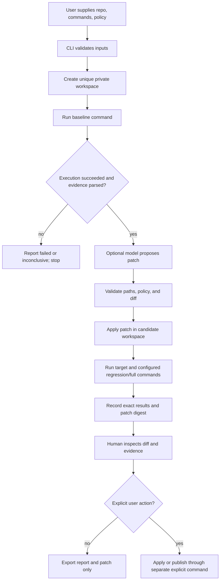

# PatchBound: Target Architecture (Contingent)

**Status:** This is a conditional design for the case where customer discovery finds a real adopter for a narrow patch-evidence workflow. It is not a recommendation to continue the current product automatically. The recommended product decision remains **G — ABANDON** until there is evidence to reopen it.

## Design goal

Build the smallest local tool that proposes a bounded patch, runs explicitly named checks, and accurately reports what happened. Do not promise correctness from a test pass, and do not run untrusted repository code on the host without an enforced boundary.

## Components

1. **CLI** — accepts repository, exact baseline command, exact candidate verification command(s), optional model, and explicit output path. No hidden command inference for a trust label.
2. **Run coordinator** — a plain Python function with explicit stages and at most a small configured retry count. No graph framework or durable orchestration service.
3. **Workspace manager** — creates a unique private temporary checkout for each run, never deletes a workspace owned by another run, and cleans up in `finally`; optional retention is explicit.
4. **Command runner** — receives argv and working directory, enforces timeout/output/resource policy, and returns exit code, signal, timeout, duration, stdout/stderr artifact references, and environment summary.
5. **Isolation backend** — for trusted local repositories, the user may explicitly choose direct execution. For untrusted repository code, use an OS-enforced disposable boundary with constrained filesystem/network/resources and process cleanup. If a supported platform cannot provide the declared boundary, fail closed or require explicit trusted-local mode.
6. **Patch proposer** — optional single model adapter producing one candidate unified diff or a bounded set of anchored edits. Validate syntax and path containment before applying. No model call is needed for ordinary verification-only use.
7. **Patch and policy validator** — checks touched paths, diff size, protected test/config files, and explicitly supported policy rules. Schema rejects unknown keys.
8. **Evidence recorder** — writes a JSON report and patch artifact. Records exact commands, test scopes, return codes, timeouts, tool versions, patch digest, policy version, and whether parsing was complete. No database or claim graph.
9. **Human review** — display exact diff and test evidence. Applying or publishing requires a deliberate user action after the report exists. The approval record identifies the human only if the chosen integration can authenticate that identity.

## Data and execution flow

The report must state the actual test scope. A successful target test is “target test passed.” It is never “full CI clean” unless the declared full command ran to completion with exit code zero. Unknown parser output or infrastructure failure is “inconclusive,” not clean.

## Interfaces

Prefer a small set of explicit Python protocols or dataclasses:

- `CommandSpec(argv, cwd, timeout, environment_policy, output_limit)`
- `CommandResult(exit_code, signal, timed_out, duration, stdout_ref, stderr_ref)`
- `PatchProposal(diff, model_id, provider_request_id)`
- `VerificationResult(scope, command, result, parsed_tests, parse_status)`
- `RunReport(run_id, base_revision, patch_digest, policy_version, verification_results, outcome)`

The interfaces should be concrete enough to test but should not create abstractions for providers, workers, storage, or policies that do not exist. Provider output is untrusted input; patch parsing and path validation remain deterministic.

## Storage requirements

- Temporary workspace and its output artifacts, with restrictive directory permissions.
- A diff artifact and one small JSON run report.
- No SQL database, vector database, content-addressed store, long-term memory, or event bus for the single-user workflow.
- Retention defaults to cleanup. An explicit `--keep-workspace` can aid debugging and must display the retained path.

## Security boundaries

- The CLI process and model credentials are outside the repository workspace.
- Model receives only the context needed for a candidate patch; no API key is included in prompt content.
- Repository code runs inside the selected execution boundary. In sandbox mode, do not mount user home, credentials, SSH agent, Docker socket, or writable host repo. Default network access is disabled unless the user opts into a specific dependency-fetch phase.
- Commands are argv arrays; no implicit shell. Reject path traversal and symlink escapes before applying edits.
- Applying a patch to the host repository and publishing a PR are separate explicit actions after review.
- Hashes identify artifacts but are not signatures. Cryptographic identity requires a real private key or authenticated service and a verification procedure.

## Failure handling

- Process nonzero exit, timeout, missing executable, crash, parser failure, and zero tests are distinct outcomes.
- A baseline command that cannot be reproduced stops repair; it is not categorized as a successful clean baseline.
- A candidate must not be called verified when tests were skipped, not discovered, or only partially parsed.
- Preserve logs and patch artifact for diagnosis; clean the workspace even when a stage raises.
- Retries are bounded and only happen after a concrete failure signal. Do not add reflection loops or model retries without measured value.
- Recovery is rerun from a clean workspace. No persistent workflow checkpoint is needed for a local CLI.

## Dependencies and trade-offs

- Keep Python and standard library for orchestration, JSON, subprocess, and basic XML parsing.
- Keep one provider SDK only if a measured user workflow needs model-generated patches. Make it optional where possible.
- Remove LangGraph, Synapse, claim/experiment subsystems, OTel plumbing, unused Git/JUnit dependencies, and GitHub automation from the minimal prototype unless a validated requirement depends on them.
- A true VM/container runner adds setup and operational burden. That burden is warranted only if the product accepts untrusted repositories. For trusted-local use, clearly state the trust assumption instead of claiming isolation.
- Full-suite execution may be expensive. Report scope honestly; do not fake broader assurance to improve completion rates.

## Migration consequences

This target changes CLI meanings, report schemas, approval semantics, provider configuration, policy schema, and feature names. Treat it as a major-version redesign if external users exist. Before removal, search published package/import/API use and issue a migration note. The repository itself does not demonstrate external consumers, so downstream compatibility is an uncertainty, not a reason to retain unused machinery indefinitely.
